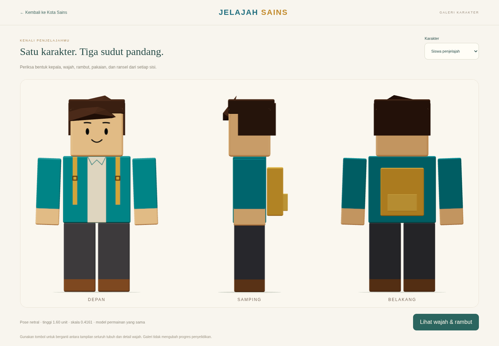
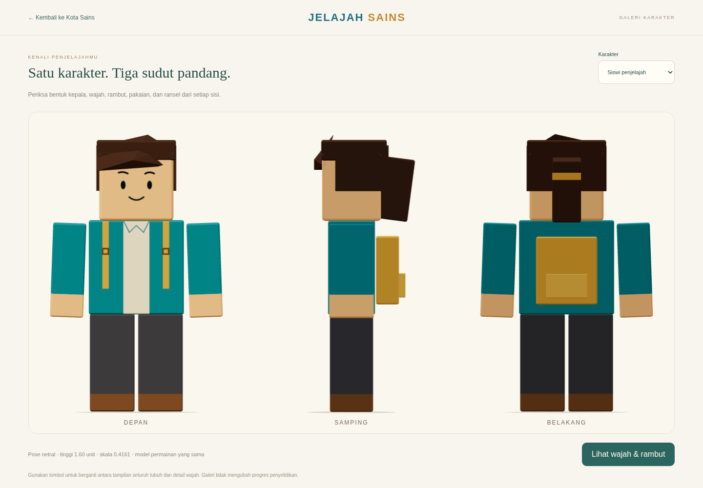
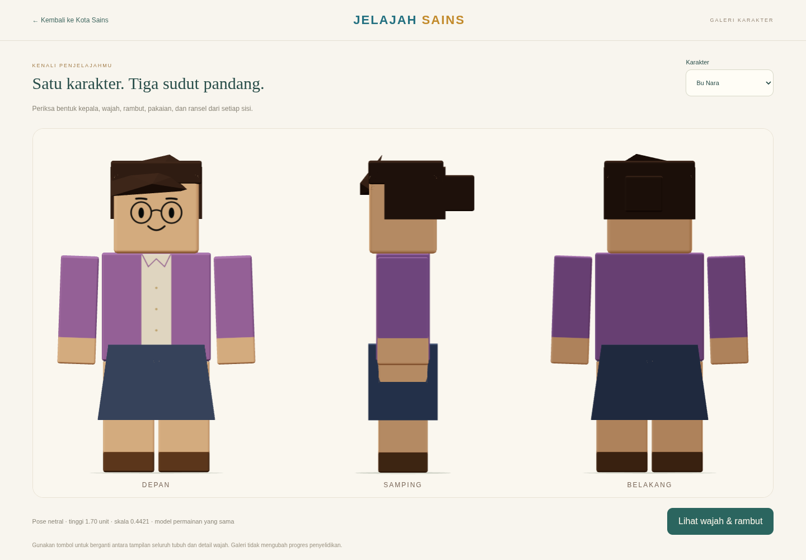
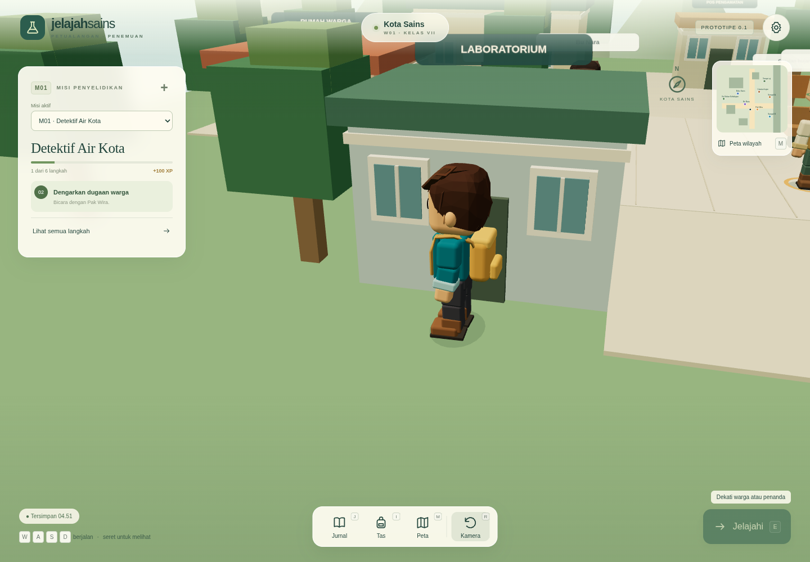
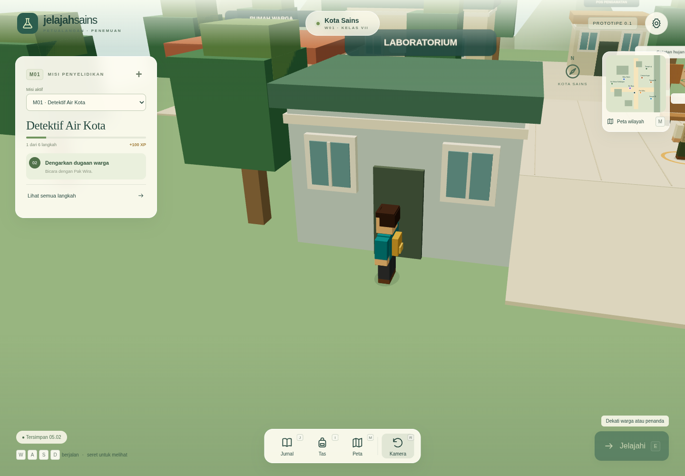

# Patch avatar balok dan proporsi lingkungan

Implementasi mengikuti acuan terbaru **Karakter Balok Sederhana**. Tidak ada wilayah, misi, atau onboarding baru pada patch ini. M01/M14 serta format penyimpanan/cadangan dipertahankan.

## Pengukuran sebelum dan sesudah

Pemeriksaan commit awal `9f8c7a3` menemukan `root.scale` dan `visual.scale` masih `[1,1,1]`, tanpa patch perkalian 0,85. Ukuran lama memang mendekati 3 unit, melampaui tinggi pintu 2,10.

Tinggi diukur dalam pose netral dari telapak hingga rambut/topi. Label, penanda, bayangan, dan semua alat di tangan diabaikan. Nilai JSON terperinci tersedia pada [pengukuran awal](evidence/block-avatar/before-measurements.json) dan [pengukuran akhir](evidence/block-avatar/after-measurements.json).

| Karakter | Tinggi lama | Tinggi dasar model baru | Faktor seragam baru | Tinggi akhir |
| --- | ---: | ---: | ---: | ---: |
| Siswa | 3,02733 | 3,84500 | 0,416125 | 1,60 |
| Siswi | Belum tersedia | 3,84500 | 0,416125 | 1,60 |
| Bu Nara | 2,92850 | 3,84500 | 0,442133 | 1,70 |
| Pak Wira | 2,99350 | 3,90500 | 0,448143 | 1,75 |
| Bu Sari | 3,01850 | 3,90500 | 0,430218 | 1,68 |

Faktor baru dihitung dari geometri dasar baru, bukan dari skala karakter yang telah diperkecil. Factory menetapkan skala visual satu kali dengan `setScalar`; root navigasi tetap 1. Membuat ulang model, memuat game, atau berpindah wilayah tidak menumpuk faktor tersebut. Telapak netral berada pada Y 0,10, sesuai permukaan jalur. Angka tinggi akhir tidak memasukkan offset lantai ini.

## Bentuk dan identitas

Kepala, torso, dua lengan dan dua kaki adalah enam balok utama. Lengan/kaki tidak memiliki mesh siku, lutut, jari, atau bantalan bahu. Mata oval hitam, alis, senyum, kacamata, dan kumis digambar pada canvas lokal transparan. Hidung/telinga/iris berpahat dihapus. Bukaan jaket, kaus, kerah, saku, tangan, sepatu, serta tali tas memakai warna/tekstur datar. Ransel siswa/siswi satu kotak dengan satu saku.

[Pak Wira tiga sisi](evidence/block-avatar/wira-three-views.png) · [Bu Sari tiga sisi](evidence/block-avatar/sari-three-views.png) · [Detail wajah siswa](evidence/block-avatar/explorer-face.png)

Rambut terdiri dari tiga bentuk besar; siswi menambah kuncir dan Nara/Sari menambah sanggul. Perbedaan siswa/siswi terbaca dari samping/belakang walaupun palet jaket sama. Bu Nara memiliki rok satu trapesium, kacamata, dan sanggul; Pak Wira memiliki topi hijau, kumis datar, rompi bersaku dan celana hijau; Bu Sari memiliki topi kebun serta apron.

Varian siswi tersedia di Galeri dan dalam permainan melalui `?avatar=siswi`. Hilangkan parameter untuk kembali ke siswa. Tidak ada reset progres atau alur onboarding tambahan; galeri mempertahankan query saat kembali bermain.

## Perbandingan terhadap pintu dan NPC

Pintu tetap 2,10 unit; bangunan dan tapak penghalang tidak diperbesar karena setelah kalibrasi pintu memberi ruang di atas rambut/topi. Jendela tetap 1,25 unit tingginya, beberapa kali tinggi wajah, bukan miniatur di samping manusia. Bangku kini setinggi 0,50 unit dan meja kebun 0,84. Pagar 1,20 tetap masuk akal. Pot/bed dan ukuran visual tanaman dirapikan; perbesaran pertumbuhan 5× dijelaskan terpisah dari tinggi dalam cm yang dicatat siswa.

[Sebelum bersama Nara](evidence/block-avatar/before-nara-dialogue.png) · [Sesudah bersama Nara](evidence/block-avatar/after-nara-dialogue.png) · [Sebelum bersama Wira](evidence/block-avatar/before-wira-dialogue.png) · [Sesudah bersama Wira](evidence/block-avatar/after-wira-dialogue.png)

Kedua tahap perbandingan memakai viewport 1440 × 1000, jarak Normal 10,8, yaw 0,25, pitch 0,46, dan pengurangan gerakan aktif. Tinggi sasaran kamera **1,02** diterapkan pada kedua tahap sebelum pengambilan gambar (nilai awal proyek 1,40). Ini menjaga kamera pembanding sama sekaligus menyesuaikan target terhadap tinggi baru. Screenshot awal dibuat dari checkout historis model lama; screenshot akhir menggunakan kode baru. Posisi aktual navigasi, kamera, dan galat browser dicatat dalam `before-capture.json` / `after-capture.json`; ada toleransi kecil akibat langkah navigasi saat berhenti.

Galeri biasa membingkai ukuran aktual untuk memperlihatkan detail. Untuk perbandingan skala tanpa pembingkaian otomatis, lihat [galeri lama dengan kamera tetap](evidence/block-avatar/before-explorer-fixed-three-views.png) dan [galeri baru dengan kamera tetap](evidence/block-avatar/after-explorer-fixed-three-views.png), atau buka `character.html?framing=compare`. Factory, tubuh, dan faktor skala sama dengan permainan; galeri tidak memperbesar model.

## Animasi, alat, dan interaksi

Ayunan berasal dari bahu/pinggul; socket siku/lutut tetap ada untuk kompatibilitas tetapi tidak membelah anggota tubuh. Perpindahan aktual setelah tabrakan menentukan langkah. Posisi root, radius navigasi 0,45, jangkauan interaksi 2,6, dan pendekatan otomatis 1,4 dipertahankan. Gerakan diam ringan, putaran terpendek, dialog berhenti berjalan, dan pengurangan gerakan tetap tersedia.

Kaki kaku mendapat koreksi sudut bawah agar tidak tenggelam. Amplitudo kaki Nara dibatasi agar bagian atas kaki tetap tertutup rok. Buku, meter, botol, penyiram dan penggaris mengikuti socket di bawah satu skala visual, tanpa pengali tambahan. Label diposisikan 0,30 di atas tubuh dan diperkecil agar tidak menutupi wajah; metadata NPC serta pemilihan raycast tetap dipakai.

[Siswi di Kota](evidence/block-avatar/after-siswi-game.png) · [Siswi di Kebun](evidence/block-avatar/after-siswi-garden.png) · [HP potret](evidence/block-avatar/after-hp-portrait.png) · [HP lanskap](evidence/block-avatar/after-hp-landscape.png)

[Cuplikan gerak model terbaru](evidence/block-avatar/motion/character-motion.webm) memperlihatkan diam, berjalan, berbelok, berhenti, menyapa, dan membaca. Rekaman dibuat dari frame WebGL; metadata merekam konteks renderer perangkat lunak. Satu sampel cuplikan melaporkan 171 draw call dan 5.378 segitiga; ini bukan benchmark FPS atau pengujian perangkat fisik. Untuk mengulang: jalankan preview produksi, lalu `EVIDENCE_ORIGIN=http://127.0.0.1:4173 EVIDENCE_OUTPUT=docs/evidence/block-avatar/motion MOTION_ONLY=1 node scripts/capture-character-evidence.mjs`.

Gambar akhir juga diambil dari build produksi melalui `EVIDENCE_ORIGIN=http://127.0.0.1:4173 node scripts/capture-block-avatar.mjs after`. Gambar awal memakai script yang sama pada checkout `9f8c7a3`, dengan tinggi sasaran kamera dibakukan ke 1,02.

## Validasi dan keterbatasan

Hasil pemeriksaan akhir:

| Pemeriksaan | Hasil |
| --- | --- |
| `npm test` | 49/49 lulus |
| `npm run build` | Lulus, permainan dan galeri |
| `npm run test:e2e` | 14/14 lulus |

Tes baru memeriksa enam balok utama, target tinggi semua varian, alat/label/bayangan yang tidak memengaruhi pengukuran, skala seragam dan tidak berulang, telapak kaki, serta batas kaki dalam rok Nara. Uji browser varian siswi memeriksa beberapa muat ulang, galeri, serta perjalanan Kota–Kebun–Kota dengan skala yang tetap. Seluruh skenario M01/M14 lama tetap lulus, termasuk kedua misi sampai hadiah, cadangan lama/baru, dan input perangkat. Pemeriksaan browser mencakup gerak/tembok, berhenti saat kehilangan fokus/dialog, raycast NPC, kontrol HP/IFP, ukuran yang tetap sama sesudah reload/perjalanan/galeri, progres lama, serta M01/M14 sampai selesai. Bukti tangkapan berasal dari WebGL, bukan gambar pengganti model.

HP/IFP fisik dan FPS perangkat sekolah belum diukur; emulasi Chromium/SwiftShader tidak menggantikan perangkat nyata. Karakter memakai siluet sederhana dengan tekstur datar, bukan model anatomi; tanaman tetap dimagnifikasi untuk membaca percobaan. Patch berikutnya sebaiknya menindaklanjuti uji perangkat serta masukan guru/siswa sebelum menambah fitur.
