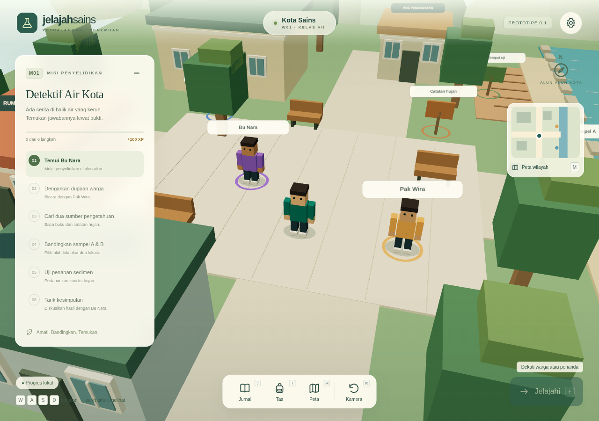
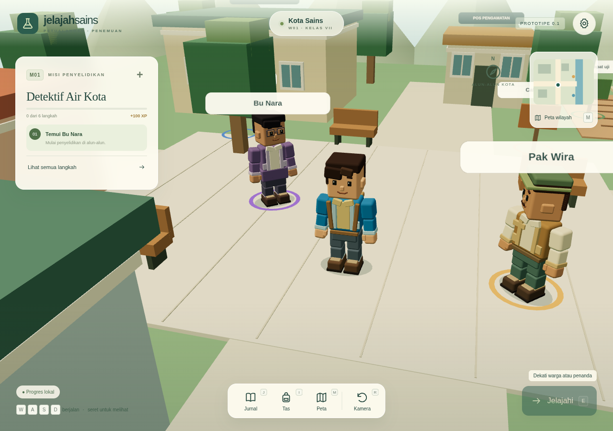
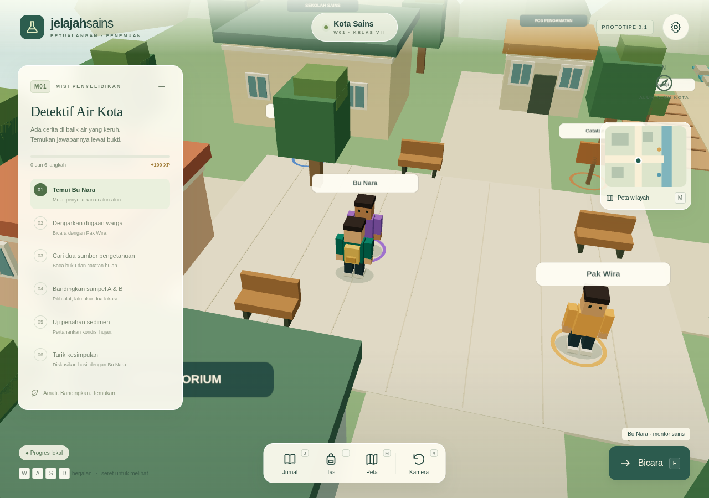
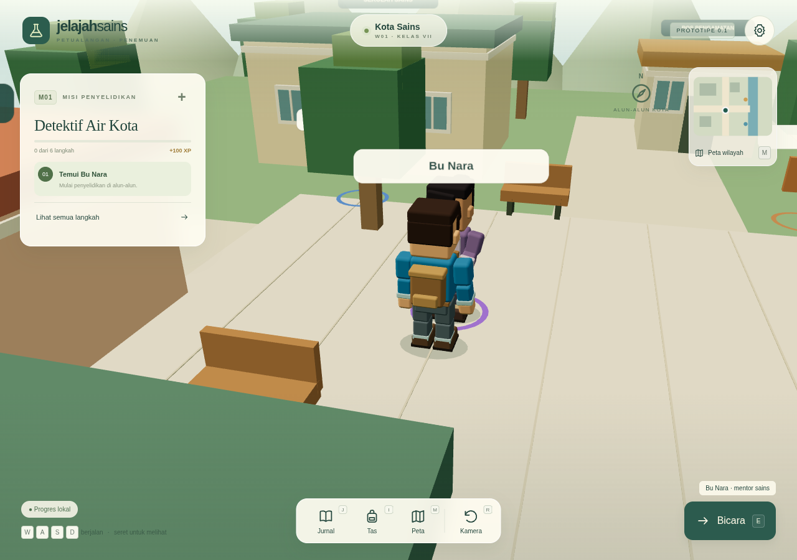
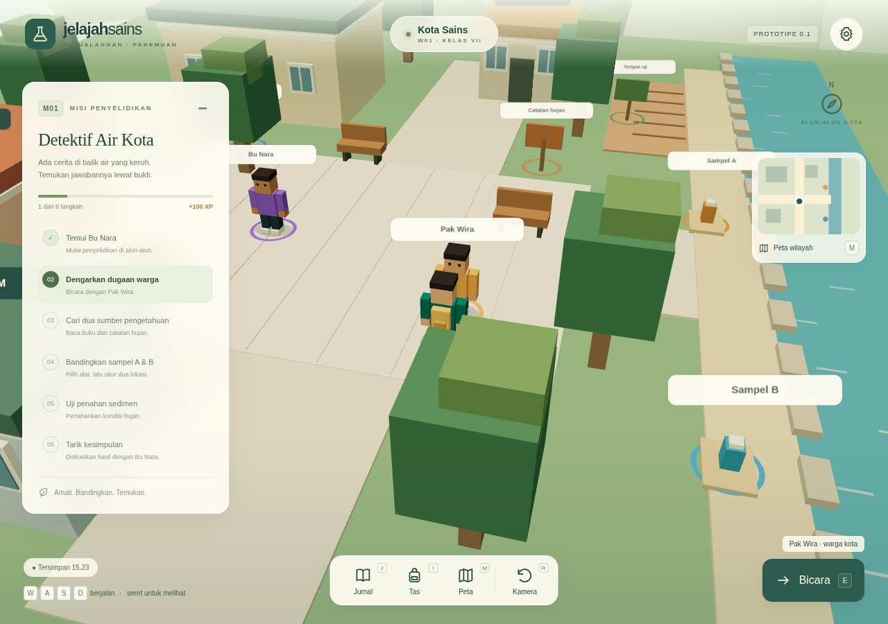
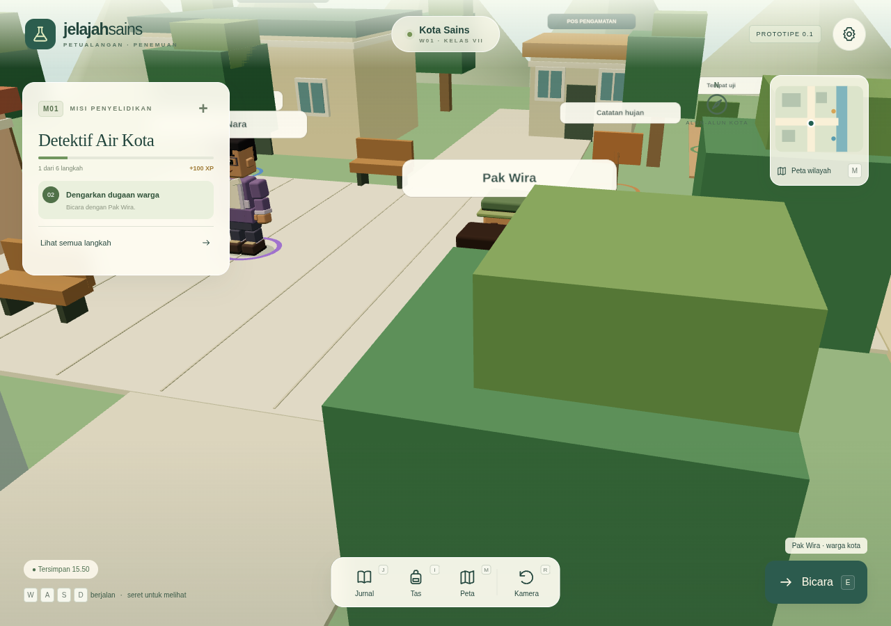
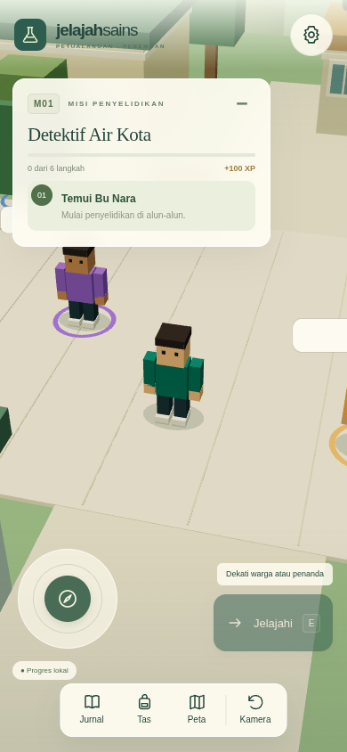
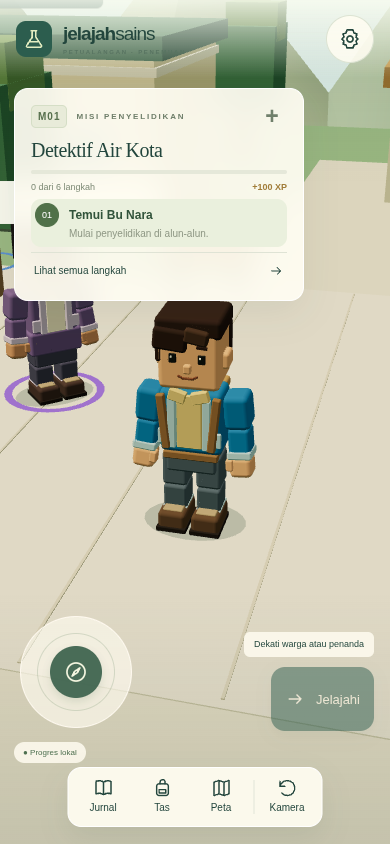
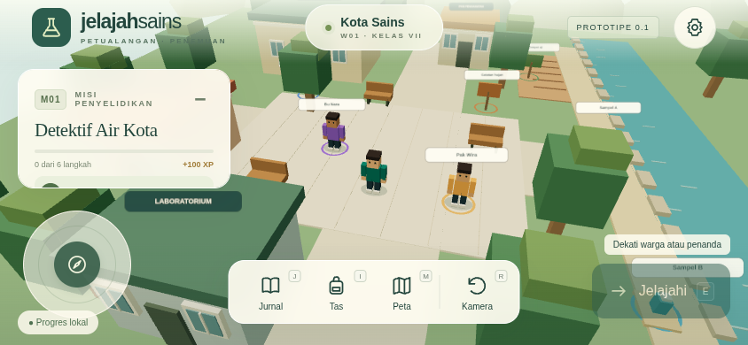
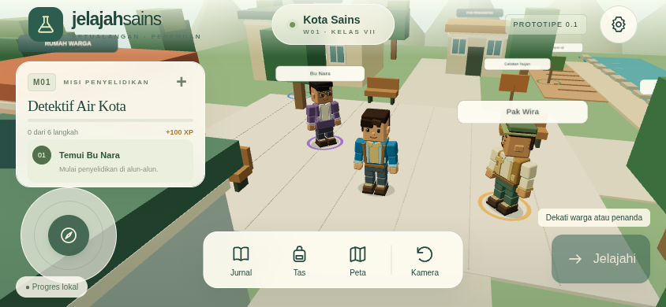

# Pemeriksaan karakter dan kamera

Laporan ini mencatat tahap karakter/kamera pada commit `8e10bcf`. Pembentukan ulang berikutnya berdasarkan acuan baru memiliki [laporan dan gambar tersendiri](reference-model-review.md).

Tahap ini menyempurnakan pemain, Bu Nara, Pak Wira, animasi, dan kamera pada Kota Sains yang sudah ada. Tidak ada penambahan wilayah atau misi. `src/game/mission.ts` dan `src/game/storage.ts` tetap menggunakan kontrak versi 1 yang sama: data A 70, B 20, uji A 35, bukti wajib, upaya kesimpulan, jurnal, hadiah 100 XP, ekspor/impor, dan IndexedDB tetap dipertahankan.

## Perbandingan pada lokasi yang sama

Gambar sebelum diambil dari commit dasar `63308f6` sebelum perubahan model. Gambar sesudah memakai posisi spawn, pendekatan Bu Nara, dan pendekatan Pak Wira yang sama. Jarak/sudut kamera sesudah sengaja berubah sesuai tujuan tahap ini. `capture-positions.json` mencatat posisi aktual dan viewport sesudah; semua gambar menggunakan rendering Three.js asli.

| Tampilan | Sebelum | Sesudah |
| --- | --- | --- |
| Pemain & alun-alun, 1280×900 |  |  |
| Bu Nara |  |  |
| Pak Wira |  |  |
| HP potret, 390×844 |  |  |
| HP lanskap, 844×390 |  |  |

## Detail dan gerak

- [Pemain dari dekat](evidence/after-player-close.png): proporsi, wajah, rambut, lapisan jaket, sendi, dan sepatu.
- [Bu Nara dari dekat](evidence/after-nara-close.png): kacamata, sanggul, cardigan, rok, dan label di atas kepala.
- [Pak Wira dari dekat](evidence/after-wira-close.png): topi, rompi, lengan gulung, dan gestur warga.
- [Menyapa](evidence/after-greeting.png) dan [membaca](evidence/after-reading.png): panel interaksi dan pose tangan.
- [Tampilan IFP](evidence/after-ifp.png): kontrol besar dan ringkasan misi.
- [Rekaman animasi WebM](evidence/character-motion.webm): diam, mulai berjalan, berbelok, berhenti, percakapan, dan pose membaca. Unduh melalui tombol **Raw/Download** pada GitHub bila pemutar Markdown tidak menampilkan video.

Rekamannya berasal dari screencast browser, bukan gambar yang digerakkan menjadi video. Skrip memakai Chromium WebGL/SwiftShader dan ffmpeg sistem. Jalankan dev server lalu `node scripts/capture-character-evidence.mjs` untuk mengulang pengambilan gambar sesudah dan video. Skrip juga menolak overlap antara area analog, dock, tombol aksi, dan panel misi pada potret, lanskap, serta IFP yang diperiksa.

## Pengujian

- `npm test`: 23 pengujian, mencakup aturan M01, seluruh rute misi, rig/sockets/metadata, berhenti di tembok, stabilitas delta time, putaran terpendek, pose alat, pengurangan gerakan, dan jarak aman kamera.
- `npm run build`: pemeriksaan TypeScript dan bundle produksi.
- `npm run test:e2e`: 7 skenario Chromium, mencakup raycast label NPC, input/dialog/fokus, pengaturan kamera, kelanjutan simpanan lama, M01 lengkap melalui IFP satu pointer, WASD, HP multitouch/cancel, ekspor/impor, hadiah, dan fallback WebGL.

**Hasil akhir:** `npm test` lulus 23/23; `npm run build` lulus; `npm run test:e2e` lulus 7/7 dalam sekitar 2,9 menit. Pemeriksaan label, tembok, fokus, pengaturan kamera, dan simpanan lama dijalankan bersama alur M01 lengkap. Tidak ada skenario yang dinonaktifkan. Pengambilan bukti juga berhasil memeriksa overlap kontrol pada tiga ukuran/mode sasaran.

Informasi pengambilan gambar dan video tersedia pada `evidence/capture-metadata.json`. Video akhir sekitar 15 detik berasal dari 142 frame screencast asli, kemudian dikodekan menjadi WebM. Pada satu tampilan pemain beserta kedua NPC, renderer melaporkan 148 draw call dan 20.134 segitiga. Angka satu tampilan ini bukan ukuran FPS ataupun jaminan performa pada seluruh peta. Video dirender dengan SwiftShader; cadence rekaman bukan benchmark perangkat fisik.

Pengujian otomatis menggunakan browser desktop dengan viewport/touch emulation. Belum ada pengujian HP dan IFP fisik, pembacaan dari jarak kelas, distribusi LAN antarperangkat, atau klaim FPS perangkat sekolah. Video membuktikan animasi dijalankan, tetapi penilaian kenyamanan tetap memerlukan pengguna/perangkat sasaran. Tidak ada aset atau layanan model eksternal yang diperlukan.
