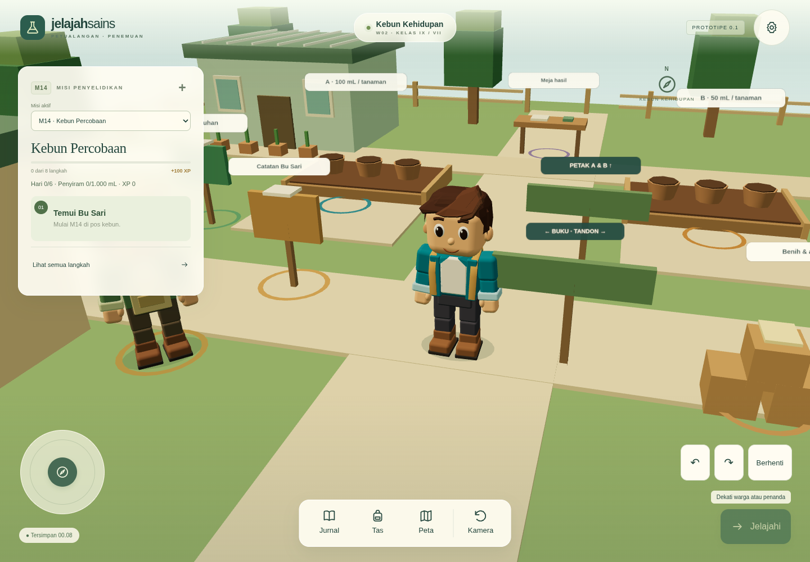
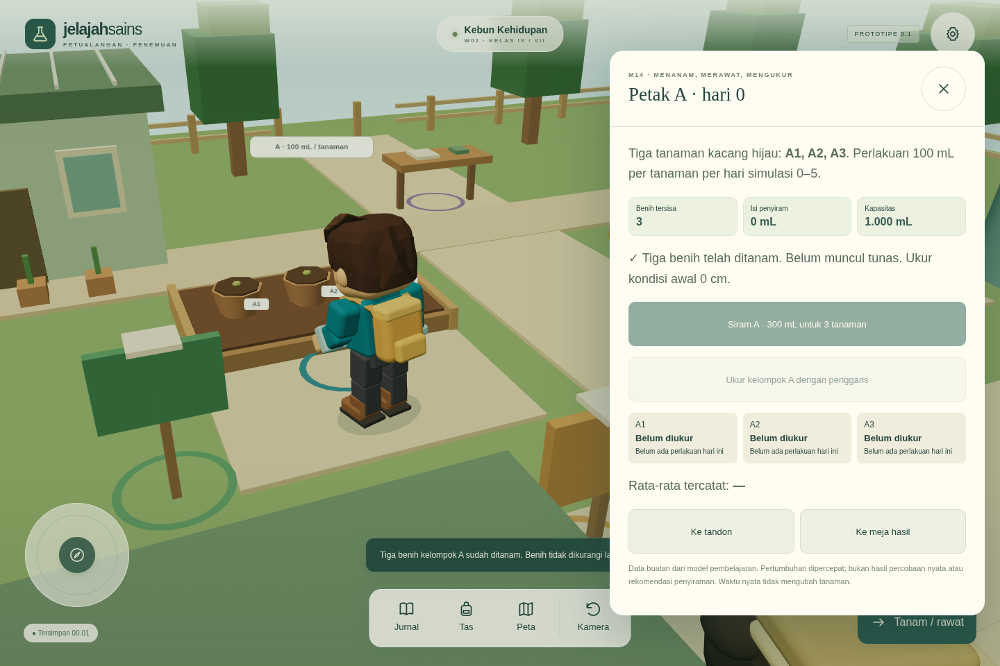
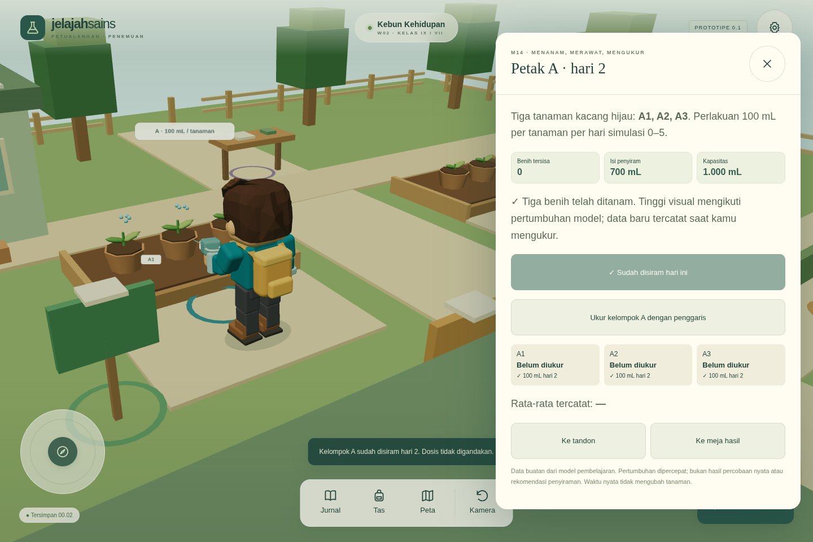
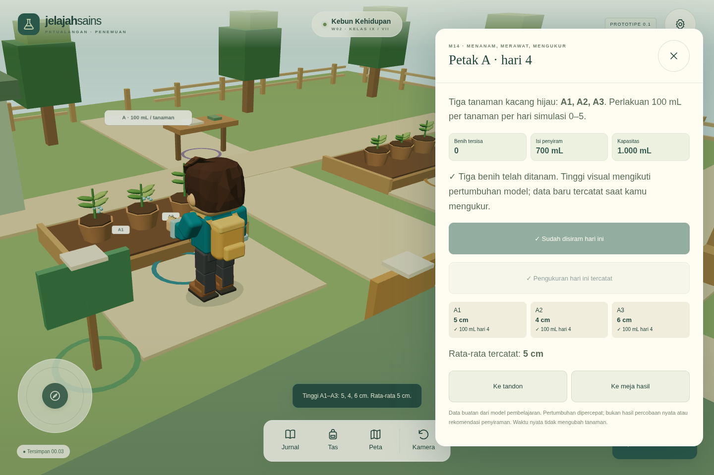
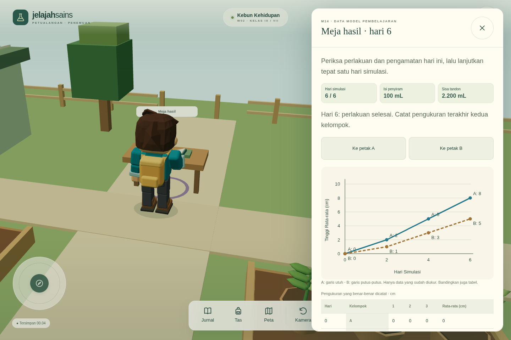
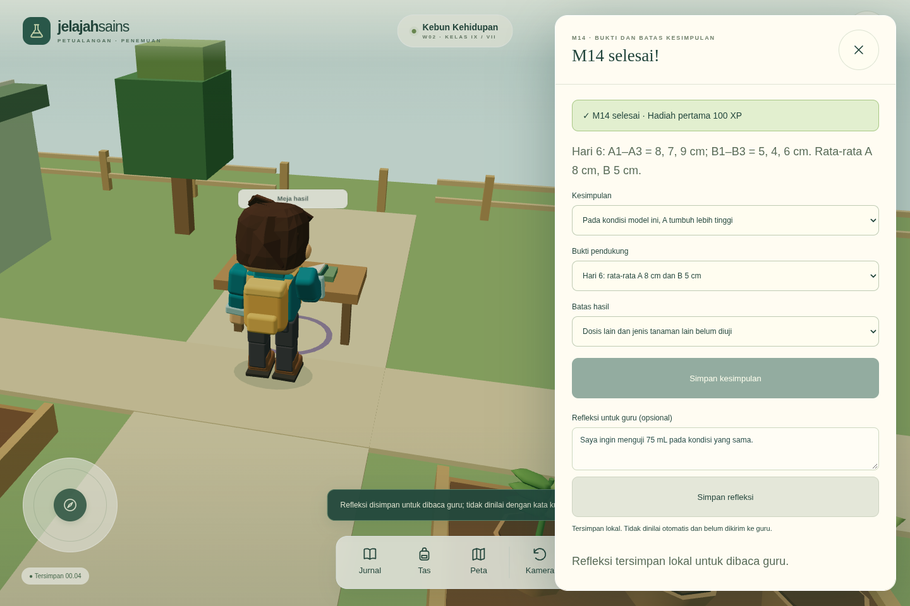

# W02 Kebun Kehidupan · M14 Kebun Percobaan

Penyimpanan terkini memakai cadangan versi 3 setelah penambahan [W03 Pos Rimba](rimba-logistics-review.md). Catatan versi 2 di bawah mendokumentasikan tahap Kebun sebelumnya; cadangan lama tetap didukung.

> Bentuk karakter pada laporan ini adalah rekaman tahap sebelumnya. Model terbaru dan ukuran terkalibrasi tersedia di [laporan patch avatar balok](block-avatar-review.md).

Tahap ini menambahkan satu wilayah dan satu percobaan utuh. Kota/M01, bentuk karakter, animator dasar, galeri, kamera, serta kontrol perangkat tetap menjadi fondasinya. M14 tidak memerlukan penyelesaian misi bernomor sebelumnya.

## Tempat dan perjalanan

Kebun memiliki gerbang kembali ke Kota, pos Bu Sari, rumah semai, tempat benih/alat, buku kebutuhan tumbuhan, catatan percobaan adil, dua petak berisi enam pot berlabel, tandon, dan meja hasil. Pagar, pohon, jalur, dan rambu memberi bentuk wilayah. Peta hanya menampilkan objek di wilayah aktif. Memilih tujuan membuat pemain berjalan ke titik pendekatan yang sah sebelum membuka tindakan; gerbang menampilkan nama tujuan dan meminta tindakan Masuk.

Misi aktif dapat dipilih dari kartu misi tanpa menghapus progres misi lain. Jika tujuan misi berada di wilayah lain, petunjuk mengarah ke gerbang. Perpindahan memakai transisi singkat, memutus rute/input lama, dan menempatkan pemain di lokasi aman. Renderer dan input dipertahankan satu kali; objek unik wilayah lama dibersihkan. Material/geometri bersama karakter tidak dibuang.

[Tampilan luas Kebun](evidence/garden/07-garden-overview.png) · [Bu Sari saat berdialog](evidence/garden/bu-sari-dialogue.png) · [Model Bu Sari tiga sisi](evidence/garden/bu-sari-three-views.png)

Label kebun dibatasi ukuran dan jaraknya. Saat berinteraksi, label objek lain disembunyikan agar tanaman dan alat tetap terlihat. Kamera melihat petak dari samping selama interaksi, lalu kembali ke sudut manual yang dipilih pemain.

## Percobaan yang dimainkan

- Terima M14 dari Bu Sari, baca dua sumber, pilih rencana satu variabel (jumlah air), dan ambil pinjaman.
- Tanam tiga benih kacang hijau per kelompok. Status petak mencegah pengurangan benih berulang.
- Isi penyiram maksimal 1.000 mL dari tandon awal 5.000 mL. Pengisian hanya memindahkan kekurangan kapasitas; contoh isi 300 mL menerima 700 mL.
- Hari 0–5: A menerima 100 mL × 3 dan B 50 mL × 3. Air kurang tidak menghasilkan perlakuan sebagian. Setiap kelompok/hari hanya dihitung sekali.
- Ukur kedua kelompok pada hari 0, 2, 4, 6. Data hari 0 adalah 0 cm setelah tanam. Membuka panel atau tumbuhnya tanaman tidak mencatat pengukuran.
- Lanjut Hari tersedia di meja hasil sesudah perlakuan serta pengamatan wajib hari itu lengkap. Satu event hanya berlaku bagi hari asalnya.
- Hari 6: bandingkan rata-rata A 8 cm dan B 5 cm. Pilih kesimpulan, bukti, dan batas model. Refleksi bebas disimpan tanpa pemeriksaan kata kunci.

Tinggi visual dan pengukuran memakai data yang ditentukan prompt. Hari ganjil diinterpolasi deterministik. Tunas serta jumlah daun berubah bersama hari simulasi; tidak ada pertumbuhan dari jam nyata atau saat aplikasi ditutup. Volume air bukan rekomendasi tanaman nyata. Materi menegaskan bahwa air berlebihan tidak selalu memperbaiki pertumbuhan.

## Jurnal, grafik, dan hasil

Jurnal menyimpan masalah/dugaan, sumber yang dibaca, rencana, variabel, perlakuan, pengukuran, grafik, kesimpulan, dan refleksi. Grafik dan tabel memakai kumpulan pengukuran yang sama. Grafik membandingkan rata-rata, memakai sumbu Hari Simulasi dan Tinggi Rata-rata (cm), label seri, serta gaya garis berbeda; tabel tetap tersedia. Pengamatan masa depan tidak ditampilkan.

Hadiah pertama 100 XP tetap tercatat setelah muat ulang, ulang percobaan, dan pemulihan cadangan yang lebih lama pada perangkat ini. Ulangi Percobaan M14 memerlukan konfirmasi dan tidak mereset M01.

## Penyimpanan dan cadangan

IndexedDB tetap skema 1 dengan object store `saves`. Key lama `M01` dibaca dengan parser yang sama; key `M14` serta `world` ditambahkan. Ketiga key disimpan atomik. Wilayah serta misi aktif dipulihkan, sementara pemain muncul di pos aman wilayah tersebut.

Cadangan gabungan versi 2 menyertakan kedua misi dan keadaan wilayah. Cadangan M01 versi 1 tetap diterima dengan penjelasan cakupan: M14 tidak diganti. Parser menolak volume negatif/berlebih, keseimbangan air yang salah, hari tidak sah, pengukuran masa depan/duplikat/diubah, perlakuan terlewat, dan hadiah tak konsisten sebelum mengubah progres. Versi format cadangan berbeda dari versi skema database.

## Pemeriksaan perangkat dan validasi

[HP potret](evidence/garden/hp-portrait.png) · [HP lanskap](evidence/garden/hp-landscape.png) · [Interaksi petak HP](evidence/garden/hp-portrait-plot.png)

Hasil pemeriksaan:

| Pemeriksaan | Hasil |
| --- | --- |
| `npm test` | 46/46 lulus: M01/M14, navigasi, air, hari, impor, karakter, kamera, pemilihan objek terlihat |
| `npm run build` | Lulus: TypeScript dan bundle permainan/galeri |
| `npm run test:e2e` | 12/12 lulus, termasuk alur M01 dan M14 lengkap sampai hadiah |
| Pemeriksaan browser setelah perbaikan titik masuk/pemilihan objek | 5/5 lulus: perjalanan, cadangan, HP, NPC, galeri |

Kasus klik ganda diuji dengan mengirim ulang event DOM yang sama untuk tanam, siram, dan Lanjut Hari. Selain nilai yang tidak berganda, tes memeriksa tidak ada galat JavaScript. Ukuran grafik diperiksa supaya tidak terpengaruh ukuran ikon global. Tes HP memakai peristiwa sentuh pada analog dan memeriksa pembatalannya. Uji pemulihan mempertahankan hari, petak, air, serta delapan pengukuran; uji cadangan memeriksa M01 v1, versi gabungan, penolakan data rusak, dan catatan hadiah saat reset. Bukti diambil dari rendering WebGL browser. Pengujian IFP memakai alur satu pointer; HP memakai emulasi sentuh. Ini bukan pengujian pada HP atau panel IFP fisik. FPS, jangkauan sentuh di kelas, dan kenyamanan layar perlu diukur pada perangkat sekolah. Materi masih memerlukan telaah guru.

Gambar kegiatan dan grafik diambil dari dev server selama tes. Gambar masuk Kebun, HP, tampilan luas, dan Bu Sari diperiksa lagi pada build produksi melalui `node scripts/capture-garden-evidence.mjs` (Node 24, `npm run preview`); keadaan hari 4 dibuat lewat aturan misi dan dipulihkan memakai UI impor. Metadata mencatat konteks pengambilan tersebut. Satu sudut dialog Bu Sari melaporkan 152 draw call dan 32.696 segitiga melalui renderer perangkat lunak; ini bukan pengukuran FPS perangkat sekolah.

Untuk mengambil ulang bukti, jalankan server dan `CAPTURE_GARDEN_EVIDENCE=1 npm run test:e2e -- --grep 'M14|garden HP'`. Tangkapan dihasilkan saat alur browser sungguhan berjalan; tes cadangan menggunakan keadaan percobaan yang valid untuk memeriksa pemulihan.

Tahap berikutnya berfokus pada telaah materi, uji perangkat fisik, dan umpan balik siswa/guru. Memancing, hewan peliharaan, kendaraan, dan wilayah tambahan belum termasuk tahap ini.
