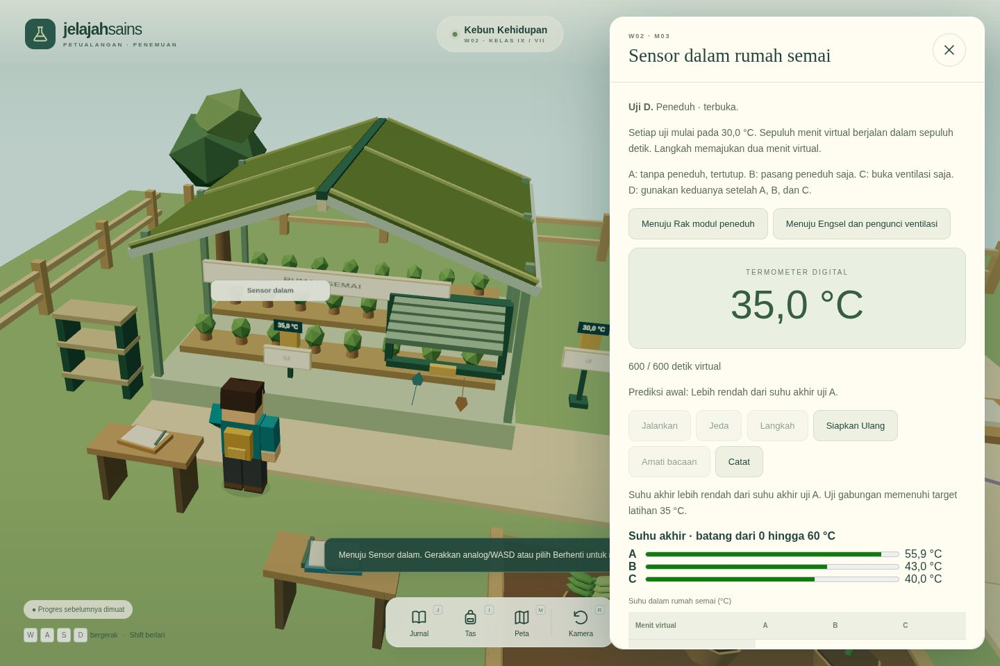

# M03 · Rumah Semai Terlalu Panas

W02 Kebun Kehidupan, kelas VII SMP. Branch `feat/m03-greenhouse-heat` berangkat dari tahap 09 (`6e4ac94`). Checkout awal bersih dan referensi lokal serta remote yang tersedia tidak menunjukkan tahap 10. Rumah semai yang sudah ada dipakai untuk stasiun termal M03. Petak, enam tanaman, air, hari, dan catatan M14 dikelola oleh misi M14.

## Cara bermain

1. Pilih **M03** pada Misi aktif. Dari Kota, pilih langkah Temui Bu Sari, berjalan ke gerbang Kebun, lalu masuk. Temui Bu Sari dan terima tugas. Pilihan **Bicara tentang M14** membuka percobaan tanaman.
2. Datangi **Buku suhu** dan **Catatan rumah semai**. Catat masing-masing bacaan. Ambil termometer digital dari meja acuan dan periksa pada kondisi acuan **30,0 °C** dalam simulasi. Ini pemeriksaan instrumen latihan; proses kalibrasi laboratorium memerlukan prosedur dan acuan tersendiri.
3. Datangi **Sensor luar** dan **Sensor dalam**. Ukur keduanya sebelum memasang modul. Suhu awal sama. Uji A menunjukkan bagaimana suhu berubah sesudah pemanasan berjalan.
4. Uji A, B, dan C di sensor dalam. Gunakan rak untuk memasang atau melepas peneduh. Di ventilasi, lepas pengunci sebelum memutar panel. Pilih prediksi, lalu **Jalankan** atau ulangi **Langkah**. Pilih **Amati bacaan** dan **Catat**. Setelah mengamati, prediksi keliru bisa dikoreksi. Jurnal menyimpan prediksi awal dan koreksi.
5. Pilih **Siapkan Ulang** sebelum mengubah alat. Gunakan keduanya pada uji D. Catat D, periksa diagram batang serta tabel di **Jurnal**, lalu laporkan ke Bu Sari. Refleksi opsional disimpan sebagai teks. A–B mendukung kesimpulan tentang peneduh, A–C tentang ventilasi, dan D menilai solusi akhir terhadap target latihan.
6. Peta dan tombol **Menuju** mengantar avatar melalui jalur yang bisa dilalui. Tombol pemasangan tersedia untuk keyboard dan sentuhan. Pengurangan gerakan menampilkan posisi akhir alat langsung. Satu detik nyata pada **Jalankan** setara 60 detik virtual, dan **Langkah** menambah 120 detik virtual. Tab tersembunyi, kehilangan fokus, atau membuka panel lain menjeda uji. Membatalkan atau memuat ulang membuang uji yang belum dicatat.

Reload mengembalikan peneduh ke rak, menutup dan mengunci ventilasi dan mengembalikan bacaan ke keadaan awal. Pinjaman dan pemeriksaan termometer serta data yang sudah dicatat tetap tercatat. Jika D sudah tercatat dan pemain baru memuat ulang sebelum melapor, pasang kembali kedua alat untuk menunjukkan solusi ke Bu Sari.

## Model dan asumsi

$$
 C\,\mathrm{d}T/\mathrm{d}t = P - K(T-T_\mathrm{luar}),
 \qquad
 T(t) = T_\mathrm{eq} + (T_\mathrm{awal}-T_\mathrm{eq})\,e^{-Kt/C},
 \qquad T_\mathrm{eq}=T_\mathrm{luar}+P/K.
$$

Suhu awal dan suhu luar masing-masing 30 °C, kapasitas efektif 6.000 J/K, dan durasi uji 600 detik. Selisih suhu menggunakan ukuran langkah yang sama pada kelvin dan derajat Celsius. Kedua suku di ruas kanan memiliki satuan watt (J/s). Koefisien `K` adalah koefisien pertukaran kalor efektif untuk model dengan satu suhu ruang. Debit udara memerlukan pengukuran dan satuannya sendiri.

| Uji | Peneduh | Ventilasi | P (W) | K (W/K) | Akhir (°C) | Target latihan |
| --- | --- | --- | ---: | ---: | ---: | --- |
| A | Lepas | Tertutup | 600 | 20 | 55,9 | Belum tercapai |
| B | Terpasang | Tertutup | 300 | 20 | 43,0 | Belum tercapai |
| C | Lepas | Terbuka | 600 | 60 | 40,0 | Belum tercapai |
| D | Terpasang | Terbuka | 300 | 60 | 35,0 | Tercapai |

Pembacaan saat uji, layar sensor 3D, grafik, dan pemeriksaan target memakai solusi analitik yang sama. Tabel memakai menit virtual 0, 2, 4, 6, 8, dan 10. Arsip menyimpan kunci konfigurasi dan versi model agar angka dapat dibangun ulang. Untuk D, nilai internal sekitar **34,9876 °C**, sehingga lulus batas ≤35 °C sebelum pembulatan. Perubahan ukuran langkah hanya memengaruhi seberapa sering suhu dibaca.

Suhu adalah besaran yang diukur termometer. Kalor adalah energi yang berpindah karena perbedaan suhu. Peneduh mengurangi masukan energi dalam model, sedangkan ventilasi memperbesar koefisien pertukaran dengan udara luar. Jika udara di luar lebih panas, efek pertukaran kalor dapat berbalik. Di rumah semai nyata, hasil juga dipengaruhi radiasi, angin, geometri, kelembapan, bahan dan tanaman. Panah pada panel hanya menunjukkan contoh pertukaran udara. Semua angka pada tabel dan target 35 °C berasal dari skenario latihan, tanpa rekomendasi suhu universal untuk bibit.

## Sumber yang ditelaah

- OpenStax *College Physics 2e*, bagian Temperature dan Heat. Naskah penerbit mendefinisikan suhu sebagai besaran yang diukur termometer dan kalor sebagai energi yang berpindah karena perbedaan suhu. [Naskah Temperature](https://github.com/openstax/osbooks-college-physics-bundle/blob/main/modules/m42214/index.cnxml) · [Naskah Heat](https://github.com/openstax/osbooks-college-physics-bundle/blob/main/modules/m42223/index.cnxml)
- Bram Vanthoor, *A model-based greenhouse design method* (2011), Bab 8. Definisi model yang diterbitkan melalui GreenLight memisahkan sifat transmisi dan refleksi radiasi layar peneduh serta fluks kalor antara udara ruang dan udara luar. [Tesis](https://edepot.wur.nl/170301) · [Definisi model Bab 8](https://github.com/davkat1/GreenLight/blob/main/greenlight/models/katzin_2021/definition/vanthoor_2011/greenhouse_vanthoor_2011_chapter_8.json)
- Katzin, van Mourik, Kempkes, dan van Henten (2020), *GreenLight – An open source model for greenhouses with supplemental lighting*. Dokumentasi model asli menjelaskan hubungan dengan model Vanthoor dan konfigurasi percobaan WUR. Parameter M03 ditetapkan terpisah untuk pelajaran. [Artikel](https://doi.org/10.1016/j.biosystemseng.2020.03.010) · [Dokumentasi kode model](https://github.com/davkat1/GreenLight/tree/main/greenlight/models/katzin_2021/definition)

## Progres dan paket

Tiga checkpoint menghasilkan satu hadiah 100 XP dan 100 Koin Sains. Bukti, XP, dan transaksi dompet disahkan dalam transaksi IndexedDB yang sama. Reset meminta konfirmasi dan mempertahankan receipt hadiah, pembelian, penampilan, dan progres lain. S02, S04, dan S20 tidak memiliki catatan penyelesaian dari M03. Cadangan v21 menambahkan M03 pada skema database 2. Cadangan v1–v20 untuk profil yang sama mempertahankan catatan M03.

Paket siap main tersedia di [unduhan/JS-Windows.zip](../unduhan/JS-Windows.zip) pada branch ini. Lihat [panduan ekstraksi dan verifikasi](../unduhan/README.md).

## Gambar dan cuplikan

[Cuplikan alur M03 dari paket produksi (WebM)](evidence/greenhouse/m03-bermain.webm)

| Langkah | Bukti |
| --- | --- |
| Temui Bu Sari dan terima tugas | [Menerima tugas](evidence/greenhouse/01-tugas.jpg) |
| Ambil termometer dari meja acuan | [Alat di meja](evidence/greenhouse/02a-termometer-di-meja.jpg) · [Meminjam alat](evidence/greenhouse/02-termometer.jpg) |
| Pasang modul di atas rumah semai | [Peneduh terbentang](evidence/greenhouse/03-peneduh.jpg) |
| Lepas pengunci dan buka panel | [Ventilasi terbuka](evidence/greenhouse/04-ventilasi.jpg) |
| Amati suhu akhir uji gabungan | [Pembacaan 35,0 °C](evidence/greenhouse/05-pengukuran.jpg) |
| Bandingkan empat hasil | [Grafik dan tabel jurnal](evidence/greenhouse/06-grafik.jpg) |
| Serahkan kesimpulan | [Penyelesaian di Bu Sari](evidence/greenhouse/07-kesimpulan.jpg) |

[HP potret](evidence/greenhouse/hp-390.jpg) · [HP lanskap](evidence/greenhouse/hp-844.jpg) · [IFP](evidence/greenhouse/ifp-1920.jpg)



## Hasil pemeriksaan

Pemeriksaan dilakukan dengan Node.js 24.22.3 dan Chromium 156 memakai SwiftShader di Linux. Viewport laptop 1440×960 dipakai untuk alur penuh. HP 390×844 dan 844×390 memakai konteks sentuh. Viewport IFP 1920×1080 memakai tombol navigasi. Viewport ini tidak mengukur performa perangkat fisik atau koneksi LAN. Arsip dan peluncur diuji setelah diekstrak di Linux. Explorer dan BAT pada Windows fisik belum dijalankan.

| Pemeriksaan | Hasil |
| --- | --- |
| TypeScript, Vite, dan persiapan produksi | Lulus |
| Vitest | 899 lulus dengan satu worker dan timeout 30 detik |
| Peluncur dan paket Windows | 16 lulus, termasuk ekstraksi dari jalur Unicode, CRC/hash, dan peluncuran tanpa npm |
| M03 dari ZIP produksi | 4 lulus. Rute penuh memblokir akses eksternal. Tes mencakup pengukuran 3D dan panel, reload ketika uji berjalan, hadiah atomik, cadangan lama dan v21, reset, dan refleksi. |
| Regresi M14 | 3 lulus. Enam tanaman, alur penyiraman, batas hari, jurnal, reset, dan viewport HP diperiksa. |
| Regresi gerak | 5 lulus termasuk ulangan tes yang mengukur laju Shift |
| Regresi ZIP tahap 09 | 5 lulus termasuk ulangan tes W08 desktop. Instrumen, EVA, lemari, galeri, menyelam dan butik diuji dengan akses eksternal diblokir. |

Putaran browser pertama menghasilkan 15 lulus dan 2 gagal. Tes laju Shift gagal pada sampel 500 ms yang memuat celah rekaman bingkai sekitar 315 ms. Tes W08 desktop mencapai pemeriksaan galeri lalu melewati batas 60 detik. Kedua tes lulus saat dijalankan ulang secara terpisah dengan batas 120 detik untuk penyelesaian seluruh tes. Tes laju lulus dalam 18,1 detik. Tes W08 desktop lulus dalam sekitar 1,1 menit.

```sh
npm run build
npm test -- --maxWorkers=1 --testTimeout=30000
npm run test:launcher
npm run test:e2e -- tests/greenhouse.spec.ts tests/runtimePackage.spec.ts tests/running.spec.ts tests/garden.spec.ts --timeout=120000
```

Untuk memeriksa M03 dari ZIP, ekstrak dan jalankan paket terlebih dahulu pada port 5173, lalu tambahkan `GREENHOUSE_ORIGIN=http://localhost:5173` pada perintah Playwright. Tambahkan `CAPTURE_GREENHOUSE=1` bila ingin memperbarui tangkapan layar dan cuplikan dipercepat. Pembuatan cuplikan memerlukan FFmpeg dengan enkoder VP9.
