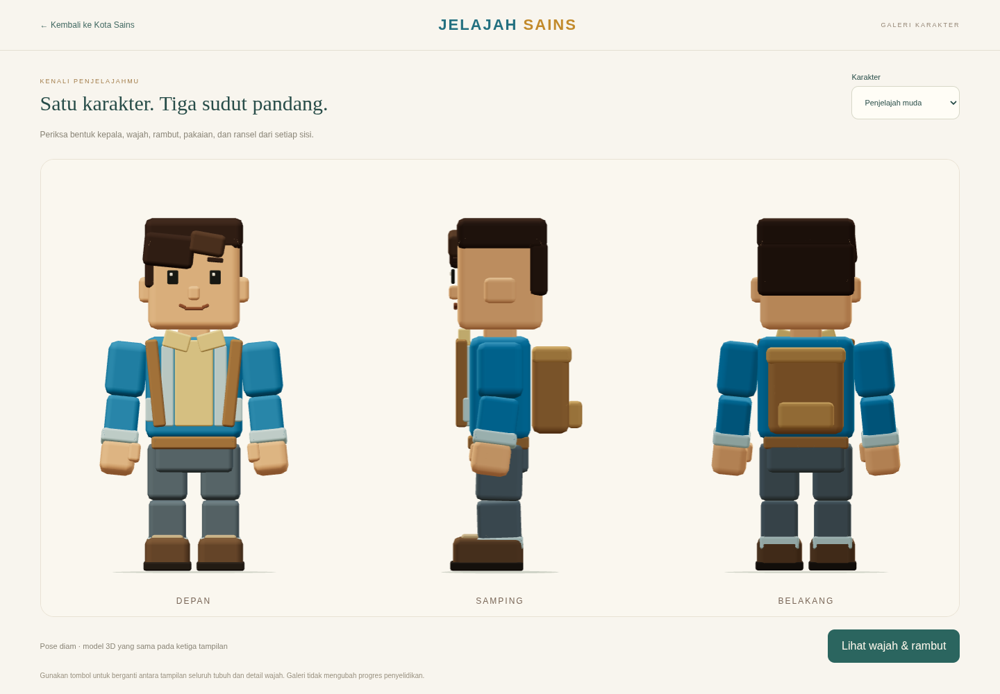
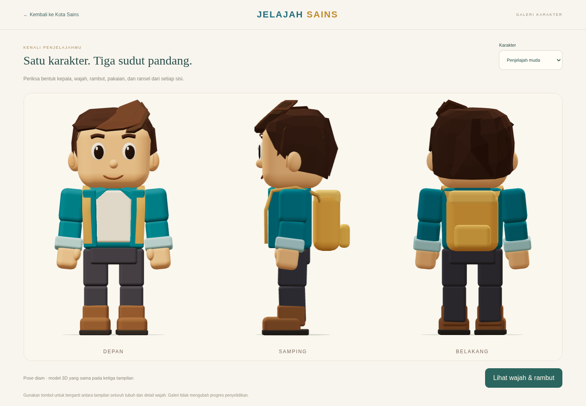
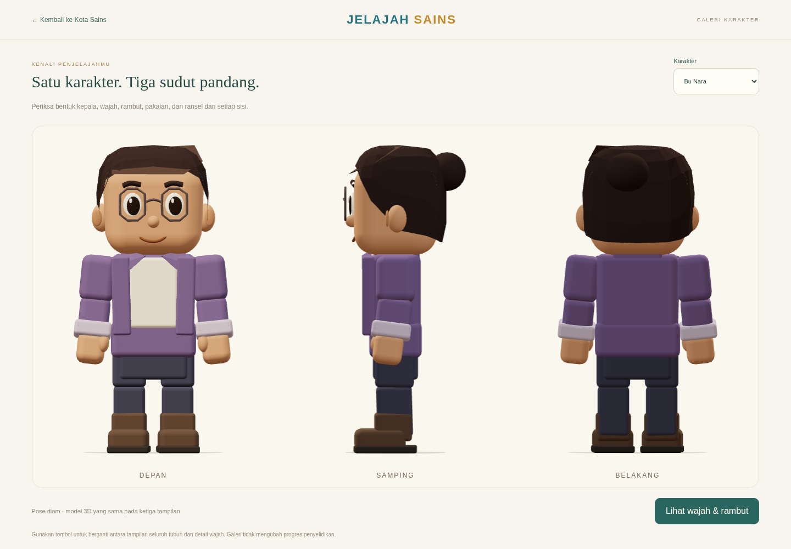
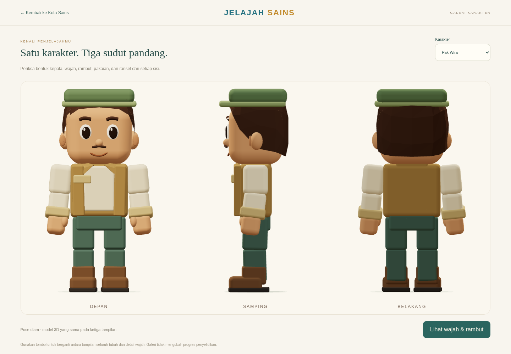
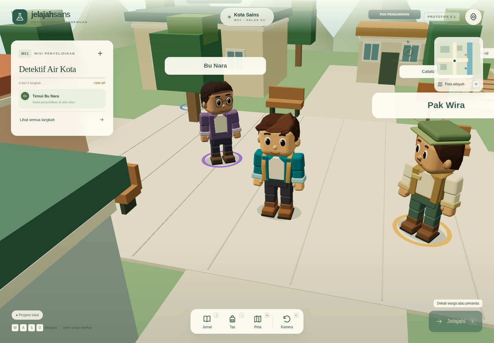

# Pembentukan ulang karakter dari acuan tiga sisi

> Bentuk karakter pada laporan ini adalah rekaman tahap sebelumnya. Model terbaru dan ukuran terkalibrasi tersedia di [laporan patch avatar balok](block-avatar-review.md).

Tahap ini memprioritaskan proporsi dan siluet pemain dari gambar acuan terbaru: kepala cukup besar, wajah ramah, rambut menyapu berlapis, jaket teal dengan kaus krem, ransel keemasan, celana abu-abu, dan sepatu cokelat. Seluruh bentuk dibuat sebagai geometri 3D lokal yang terhubung ke rig permainan.

## Urutan pemeriksaan bentuk

1. Model dasar dari commit `8e10bcf` direkam menggunakan tiga kamera ortografis pada satu model diam.
2. Pemain dibentuk dahulu. Tampilan samping mengungkap rambut yang terlalu tipis, sementara tampilan belakang mengungkap bagian kulit kepala yang belum tertutup. Volume pangkal poni, cangkang rambut, dan lapisan belakang dibetulkan.
3. Proporsi kaki/badan, garis alis, mata, bukaan jaket, posisi tali ransel, dan jarak pijakan dirapikan. Model pemain diperiksa lagi dari depan, samping, dan belakang sebelum strukturnya digunakan untuk NPC.
4. Factory dan rig yang sama diterapkan ke Bu Nara dan Pak Wira, dengan rambut, pakaian, serta aksesori masing-masing. Animator yang sudah ada dipakai untuk pemeriksaan regresi permainan.

## Pemain sebelum dan sesudah





[Detail wajah, rambut, dan kepala pemain](evidence/reference-model/explorer-face.png) · [Hasil pemeriksaan pemain sebelum penerapan ke NPC](evidence/reference-model/player-front-side-back.png)

## NPC dengan struktur yang sama





[Detail Bu Nara](evidence/reference-model/nara-face.png) · [Detail Pak Wira](evidence/reference-model/wira-face.png)

## Pemeriksaan langsung

Jalankan aplikasi melalui server sesuai README, lalu buka **Pengaturan → Galeri karakter · tiga sisi**. Halaman ini menampilkan satu model yang sama melalui kamera depan, samping, dan belakang. Tombol **Lihat wajah & rambut** memperbesar framing dan pilihan karakter mengganti pemain/NPC. Pose sengaja tetap diam; progres M01 tidak diubah oleh galeri.

Gambar di atas berasal dari tangkapan WebGL halaman tersebut, bukan ilustrasi pengganti model. Pengambilan akhir dilakukan terhadap build produksi melalui `npm run preview`. Untuk mengulangnya, jalankan server lalu `node scripts/capture-reference-model.mjs`; atur `EVIDENCE_ORIGIN` ke alamat server preview bila memeriksa build produksi.

## Tampilan dalam permainan



[HP potret](evidence/reference-model/in-game-hp-portrait.png) · [HP lanskap](evidence/reference-model/in-game-hp-landscape.png) · [Galeri pada HP](evidence/reference-model/gallery-hp-portrait.png)

Framing permainan pada layar potret diturunkan sedikit agar kepala yang lebih besar tidak tertutup panel misi. Sudut kamera manual, posisi navigasi, dan jarak interaksi tetap mengikuti sistem yang sama.

[Cuplikan model terbaru dalam permainan, 13 detik](evidence/reference-model/motion/character-motion.webm) memperlihatkan diam, berjalan, berbelok, berhenti, menyapa Bu Nara, dan membaca jurnal menggunakan animator yang sudah ada. Pemeriksaan bentuk statis dilakukan terlebih dahulu; tahap ini tidak menambahkan atau menyetel ulang animasi.

Untuk merekam ulang cuplikan tanpa menimpa bukti tahap sebelumnya:

```sh
EVIDENCE_ORIGIN=http://127.0.0.1:4173 EVIDENCE_OUTPUT=docs/evidence/reference-model/motion MOTION_ONLY=1 node scripts/capture-character-evidence.mjs
```

Metadata pengambilan gambar tersedia pada `evidence/reference-model/capture-metadata.json`. Satu tampilan Kota Sains yang memuat pemain dan kedua NPC melaporkan 149 draw call dan 45.336 segitiga. Ini data satu sudut pandang melalui SwiftShader, bukan benchmark FPS perangkat sekolah.

## Validasi

Pemeriksaan akhir lulus: `npm test` **24/24**, `npm run build`, dan `npm run test:e2e` **9/9**. Galeri dan permainan masuk dalam build produksi yang sama. Pengujian mempertahankan validasi bukti, angka A 70/B 20/uji A 35, progres lama, jurnal, hadiah, ekspor/impor, input laptop/HP/IFP, serta pemilihan NPC. Tes berjalan menunggu perpindahan nyata alih-alih mengasumsikan jumlah frame dalam waktu singkat pada renderer perangkat lunak.

HP/IFP fisik, kenyamanan dari jarak kelas, dan FPS perangkat sasaran masih perlu diperiksa pada perangkat nyata. Pemeriksaan otomatis menggunakan Chromium dengan SwiftShader; emulasi sentuh tidak menggantikan pengujian perangkat fisik.
