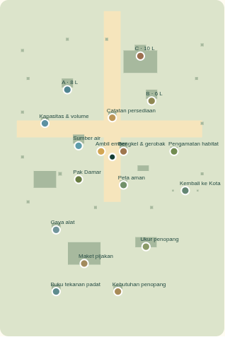
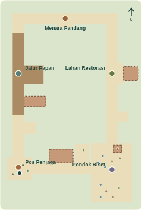
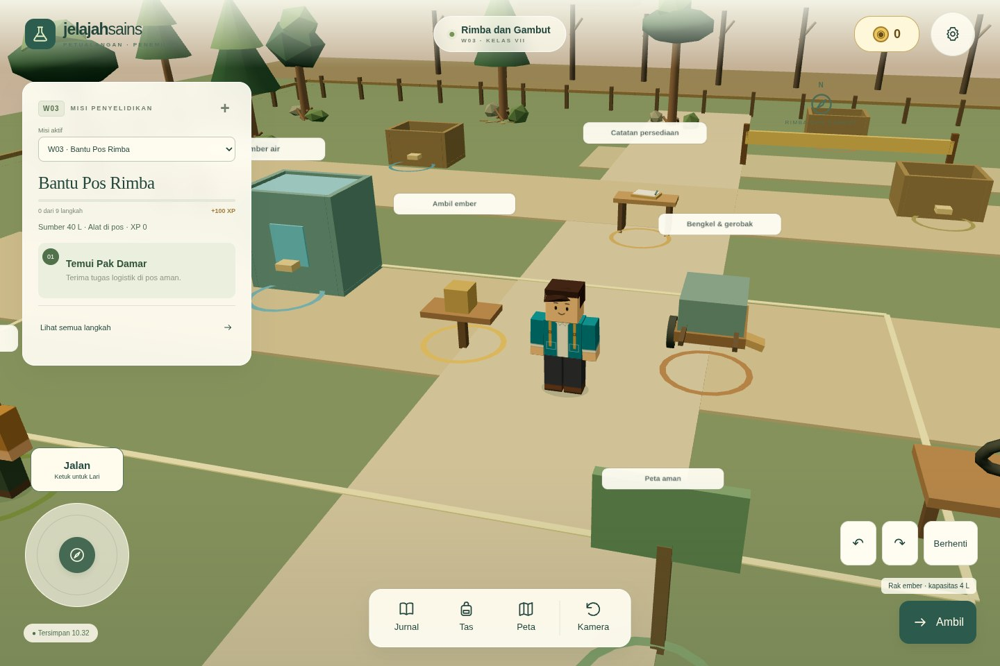
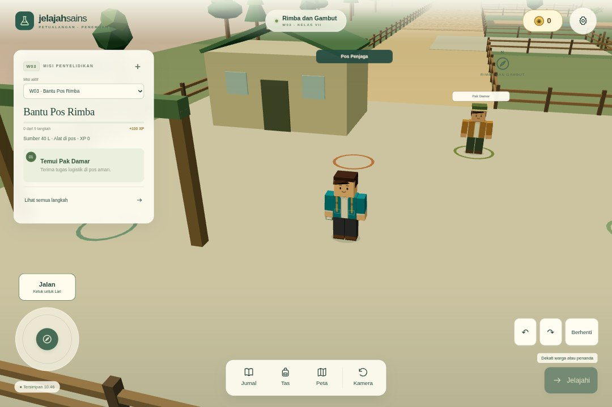
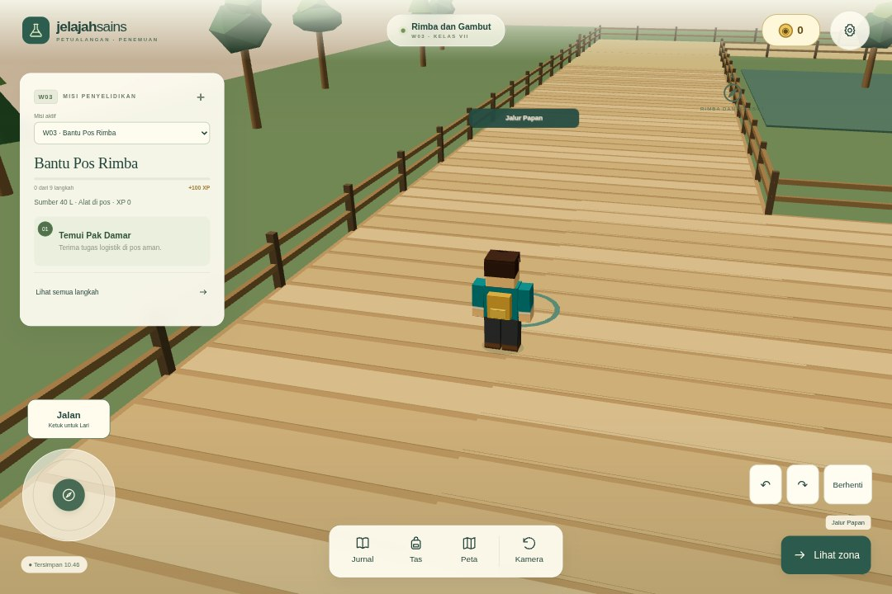
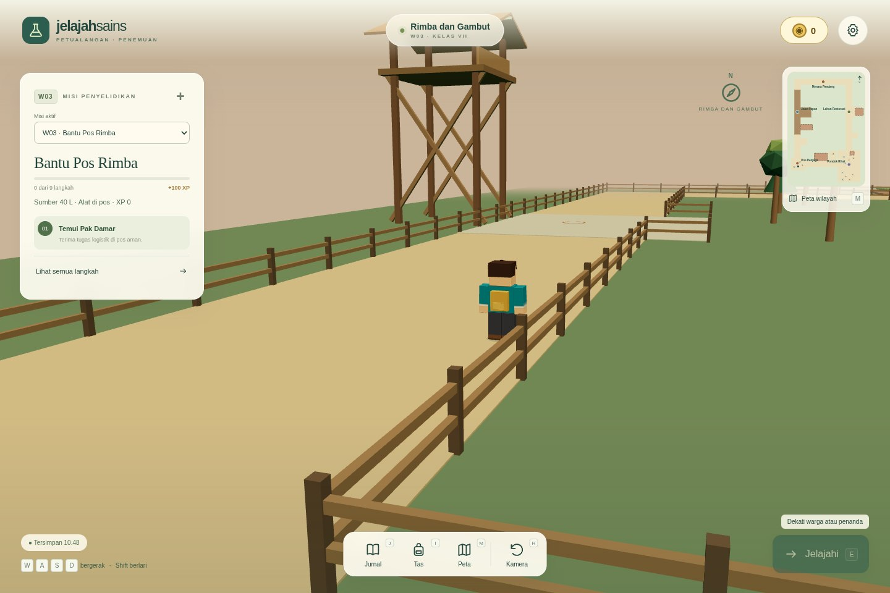

# W03 Rimba dan Gambut

Peta lima zona dikembangkan pada `feat/rimba-adventure` dari hasil M04 `461f747`. Gerbang Kota tetap menjadi pintu masuk. Pemain muncul di halaman Pos Penjaga dan dapat mengikuti putaran dengan WASD, analog, atau memilih tujuan di Peta IFP.

## Sketsa dan penempatan

```text
                                  U
               ┌──────── Menara Pandang ─────────┐
               │         pelataran bawah         │
               │                                 │
     Jalur Papan ── Ceruk pakis       Lahan Restorasi ── [lempar]
               │                                 │
               ├── [pintas celah]                 ├── Ceruk muka air
               ├── Ceruk akar                    │
Kota ─── Pos Penjaga ─┬─────────┬──────── Pondok Riset
        Pak Damar    │         │          ├── Tandon, bengkel, ember
                     │         │          ├── Penampung A/B/C
                     │         │          └── Maket M16-E3
                     │         └── Ceruk Habitat
                     └── [dorong peti]
```

| Zona | Penanda dan kegiatan yang tersedia |
| --- | --- |
| Pos Penjaga | Atap hijau, gerbang Kota, Pak Damar, dan papan peta aman. Damar tetap menerima dan menutup W03-LOG01 maupun M16-E3 sesuai misi aktif. |
| Jalur Papan | Papan melintasi tanah basah. Cabang berpagar menuju ceruk pakis. Ceruk akar menandai transisi dari tanah ke papan. |
| Menara Pandang | Siluet menara kayu terlihat dari ruas utara. Tujuan Peta tiba di pelataran bawah. Tangga menara masih ditutup. |
| Lahan Restorasi | Petak bibit terlihat dari dek tepi. Ceruk muka air menjadi singgahan di ruas ke Pondok. Petak tetap berpagar. |
| Pondok Riset | Atap biru, tandon, rak ember, bengkel roda, dan area putar gerobak bersebelahan. Penampung logistik berada di sekitar halaman. Rak penopang, pengukur gaya, buku, dan maket tetap berkelompok di sisi selatan. |

Batas jalur dan pagar mengikuti denah yang sama. Jalur utama lebarnya 10 meter model, dengan pelataran lebih lebar di Pos dan Pondok. Gerobak memakai radius tabrakan 1,65 meter model. Papan Habitat menghadap pepohonan terdampak dari cabang hutan di ruas Pos–Pondok. Letaknya mempersingkat perjalanan gerobak dari penampung C sebelum pemain kembali melapor. Peta, titik aksi, dan tabrakan Pak Damar, gerbang Kota, papan peta aman, dan Papan Habitat mengikuti posisi barunya. Semua tujuan lama masih tersedia. Penampung C tetap tertutup hingga Pak Damar mengonfirmasi jalurnya. ID misi, data penyimpanan, batas pencatatan keberangkatan dari tandon, dan format cadangan v22 memakai aturan M04.

## Waktu tempuh

Pengukuran dilakukan di Chromium dengan SwiftShader, viewport 1440 × 960, rasio piksel 0,75, dan kualitas rendah. Setiap ruas dimulai setelah satu tujuan tercapai. Tujuan berikutnya dipilih di Peta IFP dengan mode **Jalan**. Jarak dijumlahkan dari perubahan koordinat avatar yang tampak pada setiap bingkai. Waktu dimulai pada perpindahan pertama dan berakhir pada perpindahan terakhir, di luar pembacaan panel, jeda, dan klik Peta. Sampel koordinat membulatkan posisi ke 0,01 m. Sebagai pembanding, uji mesin gerak menjalankan lintasan yang sama pada langkah 1/120 detik dengan kecepatan jalan 5,2 m/s dan mengukur setiap perpindahan, termasuk langkah saat mulai bergerak.

| Ruas yang ditapaki | Jarak browser | Waktu browser | Waktu mesin gerak |
| --- | ---: | ---: | ---: |
| Pos Penjaga → Jalur Papan | 82,36 m | 17,15 dtk | 16,61 dtk |
| Jalur Papan → Menara Pandang | 88,97 m | 17,88 dtk | 18,01 dtk |
| Menara Pandang → Lahan Restorasi | 89,50 m | 17,72 dtk | 18,01 dtk |
| Lahan Restorasi → Pondok Riset | 88,18 m | 18,09 dtk | 17,81 dtk |
| Pondok Riset → Pos Penjaga | 84,29 m | 17,12 dtk | 17,01 dtk |
| **Satu putaran** | **433,30 m** | **87,96 dtk** | **87,45 dtk** |

Kelima ruas memenuhi sasaran awal 15–25 detik. Catatan ini memakai satu putaran yang dijalankan dari Peta. Waktu jalan manual dan perangkat fisik dapat berbeda.

## Kandidat checkpoint

| Lokasi | Kandidat kegiatan |
| --- | --- |
| Pos Penjaga | Mulai M05 bersama Pak Damar dan pilih titik pengamatan. Gunakan halaman sebagai titik pemulihan atau penutup rute. |
| Ceruk pakis, ceruk akar, dan ceruk Habitat | Catat tiga ciri organisme tanpa mengambilnya, lalu kelompokkan temuan untuk M05 atau S07. |
| Pelataran Menara Pandang | Bandingkan tajuk dan tepian dari titik aman. Catat dugaan hubungan enggang dan tumbuhan untuk M06 atau S08. |
| Tepi Lahan Restorasi | Bandingkan petak terbuka dengan petak bibit lokal dan pilih lokasi pemulihan dari bukti untuk M06 atau S09. |
| Pondok Riset | Simpan atau bandingkan catatan dari dua titik dalam satu panel. Alat M16-E3 dan logistik tetap siap digunakan. |

Tiga lokasi latihan sudah memiliki ruang dan penanda **Ditutup**. Calon pintasan celah berada di sisi dalam Jalur Papan, petak dorong peti di sisi utara ruas Pos–Pondok, dan tempat lempar keranjang di tepi Restorasi. Pagar dan batas navigasi menutup area itu bagi pemain dan gerobak. Tidak ada aksi, hadiah, atau syarat lompatan pada tahap ini.

## Sebelum dan sesudah

| Sebelum di M04 | Sesudah di branch W03 |
| --- | --- |
|  |  |
|  |  |





## Verifikasi regresi

- Build produksi dan TypeScript lulus. Vitest mencatat 908 tes lulus, termasuk jalur ke semua tujuan lama, kelima ruas baru, akses gerobak, dan batas fisik tiga area tertutup. Enam belas tes peluncur lulus.
- Sembilan skenario W03-LOG01 dan M16-E3 lulus di Chromium setelah pengujian ulang gerobak laptop. Skenario itu awalnya gagal dengan batas lama `z < 3,15`. Commit dasar M04 mereproduksi `z = 3,28` karena meja catatan sedalam 0,65 m. Uji akhir memakai dimensi meja dan radius gerobak yang berlaku, serta memeriksa gerobak berhenti, roda tidak terus berputar, dan parkir memulihkan kecepatan normal.
- Satu skenario kendali kargo M04 pada HP potret juga lulus. Pemeriksaan sentuh memakai emulasi Chromium.
