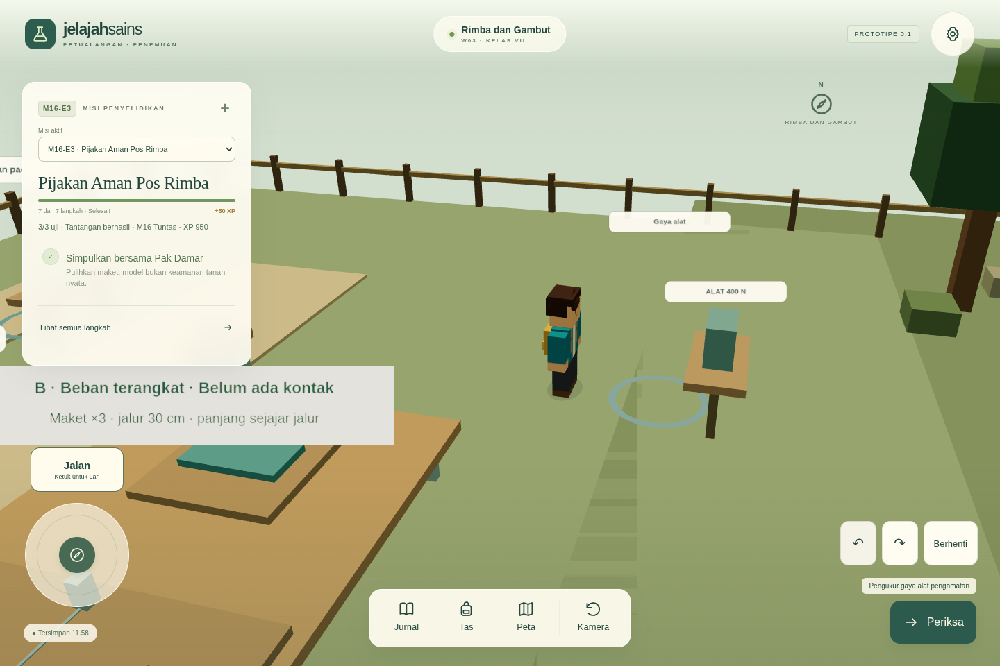
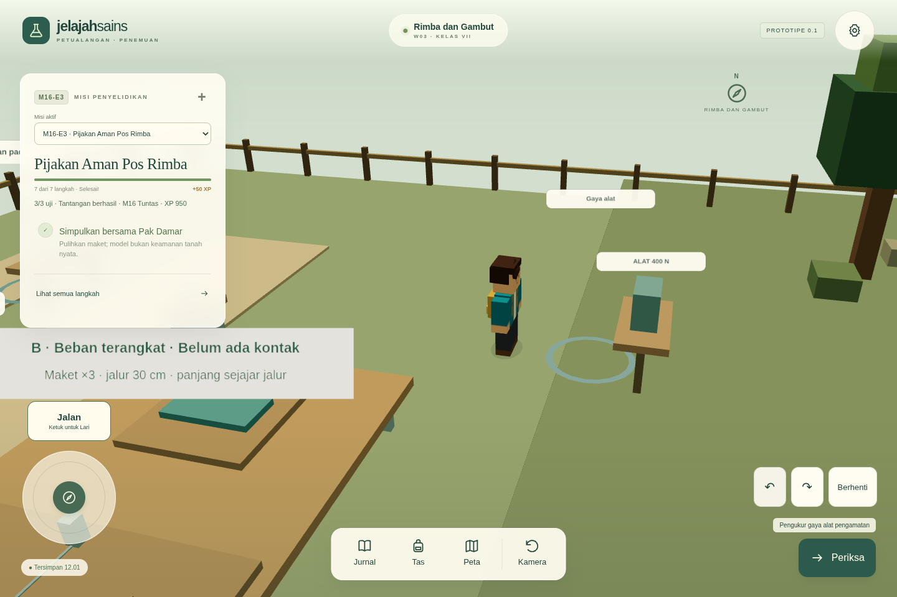

# Visual tahap 01 — stabilitas rendering

Pemeriksaan 28 Oktober 2026 (Asia/Bangkok). Dasar `41fae903a1f425c88ab87e17e16fd34884523a04` pada branch M02 adalah kode terbaru yang tersedia; `main` masih `afda146`. Tidak mengembalikan kode ke baseline lama pada lampiran. AGENTS.md tidak ditemukan pada direktori proyek/induk. README, rancangan, sumber renderer, kamera, material, preferensi dan pergantian wilayah dibaca.

## Hasil dan cara memeriksa

Masuk W03, pilih M16-E3, gunakan Peta → Gaya alat; tutup panel, putar kamera dan berjalan di sambungan pos–area maket. Di W06, gunakan Peta → Kebutuhan peti pada halaman hidraulik dan lakukan hal yang sama. Pengaturan → Kualitas Rendah mengurangi batas rasio piksel; hapus centang untuk Normal. Jarak kamera dan Kurangi Gerakan tetap tersendiri.

Dua bidang tanah tambahan kini berakhir tepat di batas tanah lama. Tidak ada pengubahan navigasi, alat percobaan, skala karakter, kecepatan jalan/lari atau aturan misi. Nilai pencahayaan/material lingkungan lama dipusatkan agar perubahan berikutnya mudah ditinjau. Tidak ada penghapusan penyimpanan, perubahan XP, format cadangan atau IndexedDB. Format tetap **v17**; seluruh 17 misi dan delapan wilayah tetap tersedia.

## Diagnosis yang dibuktikan

| Lokasi | Kondisi sebelum | Perbaikan |
| --- | --- | --- |
| W03 sambungan pos–maket | Tanah pos x −21…21, z −20,5…22,5; tambahan x −19…19, z 18…38. Dua warna memiliki bidang atas y −0,05. Tumpang tindih 38 × 4,5 = **171 unit²**. Pola bidang berubah saat kamera bergerak. | Tanah tambahan mulai z 22,5 dan tetap berakhir 38; kedalaman 15,5, pusat z 30,25. Pos memiliki permukaan pada area lama. |
| W06 sambungan Bengkel–hidraulik | Tanah Bengkel x −20…20, z −20…20; tambahan z 18,5…37,5. Bidang atas sama y −0,05. Tumpang tindih 40 × 1,5 = **60 unit²**. Berebut warna saat pandangan berubah. | Tambahan mulai z 20 dan berakhir 37,5; kedalaman 17,5, pusat z 28,75. |

`groundLayout.ts` menurunkan batas tambahan dari tepi tanah induk, bukan menambahkan offset kedalaman sembarang. Jalur dan seluruh objek tetap pada koordinat semula; tidak muncul lubang. Perubahan hanya pada luas tersembunyi yang sebelumnya digambar dua kali. Jumlah mesh/triangles tidak harus turun ketika kotak dipotong; ini perbaikan ketepatan permukaan, bukan klaim optimasi FPS.

Pemeriksaan lain:

- **Depth buffer:** browser pengujian melaporkan 24 bit dan 4 samples; context antialias/depth aktif. Near/far tetap 0,1/110 dan FOV 48°. Mengubah clip range tidak menyelesaikan dua permukaan yang benar-benar sama bidangnya dan dapat merusak kamera alat/ROV. Tidak mematikan depth test/write.
- **Bayangan:** baseline tidak mengaktifkan shadow map dinamis. Cakram bayangan kontak avatar tetap ada, transparan dengan depthWrite false. Pola tanah pada daerah overlap berbeda dari bayangan yang mengikuti kaki; tidak menghilangkan bayangan untuk memperbaiki ini.
- **Transparansi air:** permukaan laut W05 memakai depthWrite false; air sungai dasar buram dan riaknya transparan. Tidak ada bukti dari lokasi uji bahwa air menyebabkan dua sambungan tanah di atas; tidak mengubah transparansi seluruh air atau alat kaca. Audit menyeluruh seluruh sudut air belum dilakukan.
- **Objek ganda:** capture dan siklus wilayah memeriksa satu `active-region`. Yang terbukti ganda adalah cakupan dua bidang tanah dalam satu wilayah, bukan dua renderer atau seluruh wilayah terduplikasi.
- **Gerigi tepi:** batas warna tanah, pagar dan tepi bangunan masih dapat bergerigi pada piksel layar. Ini berbeda dari patch warna permukaan yang berebut. Normal membatasi DPR 1,5, Rendah 1; keduanya memakai context antialias yang sama. Rendah bukan obat z-fighting.

## Bukti dari build produksi

Seluruh gambar berasal dari game sebenarnya, Chromium 154 / SwiftShader, tanpa aset jaringan. Pasangan fixed memakai 1440×960, DPR 1, jarak Normal, yaw 0,250 dan reset kamera yang sama. Posisi berikut dibuktikan dalam JSON capture: Rimba (−10; 23,4), Bengkel (8; 23,4), Kota (−7,5; 8,4). Fixture progres sama: `docs/evidence/market/completed-v17.json`, diimpor melalui antarmuka. Tidak membuat rekaman misi palsu untuk mendapatkan sudut kamera.

| Lokasi | Sebelum | Sesudah | Kamera bergerak + berjalan |
| --- | --- | --- | --- |
| Rimba / Gaya alat | [fixed](evidence/visual-stage-01/before-rimba-fixed.png), [putar](evidence/visual-stage-01/before-rimba-rotated.png) | [fixed](evidence/visual-stage-01/after-rimba-fixed.png), [putar](evidence/visual-stage-01/after-rimba-rotated.png) | [sebelum](evidence/visual-stage-01/before-rimba.webm) · [sesudah](evidence/visual-stage-01/after-rimba.webm) |
| Bengkel / Kebutuhan peti | [fixed](evidence/visual-stage-01/before-workshop-fixed.png), [putar](evidence/visual-stage-01/before-workshop-rotated.png) | [fixed](evidence/visual-stage-01/after-workshop-fixed.png), [putar](evidence/visual-stage-01/after-workshop-rotated.png) | [sebelum](evidence/visual-stage-01/before-workshop.webm) · [sesudah](evidence/visual-stage-01/after-workshop.webm) |
| Kota / Meja perubahan wujud (kontrol) | [fixed](evidence/visual-stage-01/before-town-fixed.png) | [fixed](evidence/visual-stage-01/after-town-fixed.png) | [sebelum](evidence/visual-stage-01/before-town.webm) · [sesudah](evidence/visual-stage-01/after-town.webm) |

Contoh sudut putar yang memperlihatkan sambungan Rimba:

Sebelum:

Sesudah:

[Metadata sebelum](evidence/visual-stage-01/before-capture.json) dan [sesudah](evidence/visual-stage-01/after-capture.json) menyimpan viewport, posisi, kamera, depth, samples, jumlah akar/geometri/tekstur/draw call dan durasi screencast. Video memakai urutan tombol yang sama; waktu antarframe tidak identik pada renderer perangkat lunak. PNG fixed lebih tepat untuk perbandingan kamera; video membuktikan gerak, bukan benchmark perangkat fisik.

Script `scripts/capture-visual-stage-01.mjs before|after` menjalankan server produksi pada port uji sementara yang terisolasi. Peluncur harian dan origin tetap localhost:5173. Satu game renderer tetap digunakan; CDP hanya merekam layar. Video disandikan WebM secara lokal. Tidak mengedit gambar game untuk menutupi artefak.

## Pemeriksaan

- `npm test`: **705 lulus / 22 berkas**, termasuk lima pemeriksaan baru geometri, kepemilikan permukaan, material/depth, pencahayaan dan batas DPR.
- `npm run test:launcher`: **14 lulus**.
- `npm run test:e2e` dengan seleksi yang tersimpan pada [verification.json](evidence/visual-stage-01/verification.json): **14 lulus**, sekitar 5,8 menit. Mencakup alur penuh M16-E2 dan M16-E3, gerobak, Shift/jalan/lari, analog + kamera HP, build produksi/seluruh model galeri offline pada empat viewport, preferensi kualitas DPR 2/reload dan dua siklus Rimba–Kota–Bengkel.
- `npm run build`: **lulus**; peringatan chunk >500 kB yang sudah ada tetap tercatat.
- `npm run prepare:local`: **lulus**, sesudah build final; aset game `game-DBDqLxBU.js` sama dengan build pada capture sesudah. Peluncur membuka build produksi terbaru.
- `git diff --check` dan pencocokan metadata kamera/viewport/depth pasangan capture: **lulus**. [Hash sumber](evidence/visual-stage-01/source-verification.json) dan [hash PNG/WebM](evidence/visual-stage-01/capture-files.json) tersedia.

[Siklus sumber daya](evidence/visual-stage-01/resource-cycles.json) menunjukkan satu akar aktif, 215 geometri dan 74 tekstur pada kedua kunjungan Bengkel (penghitung disposal 3 → 7). Ini menguji pengulangan kunjungan yang dipilih, bukan benchmark/sesi panjang. Perbandingan seluruh data misi mengabaikan hanya `M01.savedAt` yang memang diperbarui autosave; bukti, status, XP dan receipt tetap dibandingkan.

Empat uji kualitas: [laptop](evidence/visual-stage-01/quality-low-1440x960.png), [HP potret](evidence/visual-stage-01/quality-low-390x844.png), [HP lanskap](evidence/visual-stage-01/quality-low-844x390.png), [IFP](evidence/visual-stage-01/quality-low-1920x1080.png). Tidak ada overflow horizontal. Preferensi lama tetap dimuat, Rendah/Normal dapat diganti, dan data misi tetap sama setelah reload.

Pada percobaan awal, pemeriksaan baru memakai ID beban yang keliru, mengharapkan teks status “Tersimpan” setelah reload, dan membandingkan timestamp autosave sebagai data progres. Asumsi uji diperbaiki; pemeriksaan final di atas lulus. Seluruh suite browser tidak dijalankan ulang: seleksi mengikuti dampak geometri W03/W06, material bersama, kualitas, pergantian wilayah dan launcher; aturan seluruh misi dicakup unit test.

## Batas dan pekerjaan berikutnya

Kedua sambungan tanah tidak lagi saling menimpa secara geometri dan pola warna berebut tidak terlihat pada lintasan kamera uji sesudah. Kota pada lintasan pasar menjadi kontrol tanpa perubahan geometri. Ini bukan jaminan seluruh sudut delapan wilayah bebas artefak: air berlapis, detail sangat jauh, GPU/driver lain dan sesi panjang masih memerlukan pemeriksaan lanjutan bila ada reproduksi.

Pengujian memakai browser Linux dengan renderer perangkat lunak. HP potret/lanskap dan IFP adalah simulasi viewport/sentuhan, bukan perangkat fisik. BAT Windows, LAN dari perangkat lain dan performa HP fisik tidak diuji langsung pada tahap ini. Tidak menambahkan shadow map, efek pascaproses, ketajaman tekstur, atau perombakan Kota. Peringatan bundle besar yang sudah ada dicatat, bukan diselesaikan dengan perubahan arsitektur pada patch diagnosis ini.

[Rencana visual sepuluh tahap](visual-upgrade-plan.md) memuat palet seluruh wilayah, proporsi, cahaya, kualitas dan gerbang pemeriksaan. Tahap 02 dan seterusnya belum dikerjakan.
