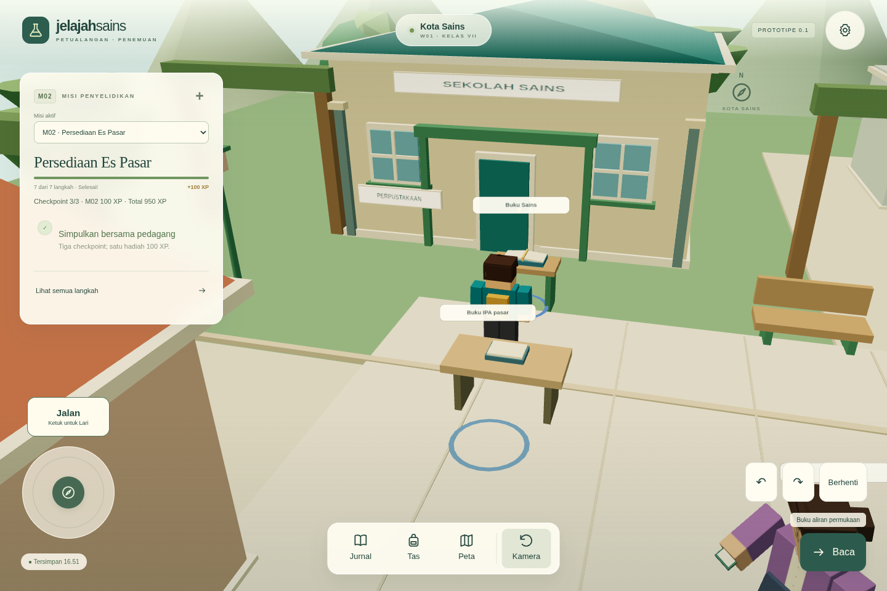
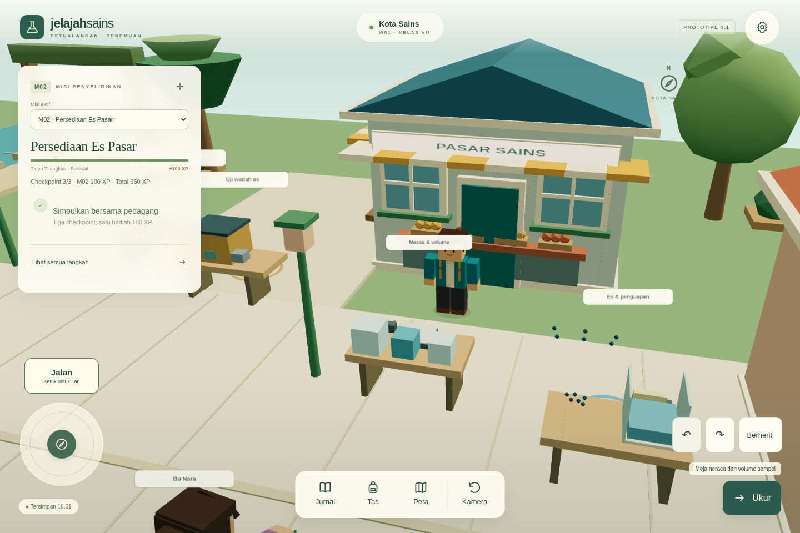

# Visual tahap 02 — Kota Sains

Mulai diperiksa 28 Oktober 2026 (Asia/Bangkok), dari `53aa11ef198deb7285578e1815e5be510608b9fc` pada `feat/visual-stage-01`. Branch tersebut memuat M02 dan cadangan v17, lebih baru daripada main. Perbaikan tahap 01 dipertahankan. AGENTS.md tidak ditemukan di proyek atau direktori induk. README, rancangan, rencana/laporan visual 01, builder Kota, kamera, interaksi, navigasi, material dan pelepasan wilayah diperiksa.

## Perubahan yang dapat dimainkan

`townEnvironment.ts` memisahkan seni lingkungan dan aktivitas Kota dari aturan misi. Fondasi dan koordinat interaksi tetap sama.

- Sekolah memiliki atap segitiga dengan tepian tebal, pilar, pintu 2,10 m, kusen silang, gerbang terbuka, serta bagian perpustakaan pada fasad. Rumah warga menjadi tempat baca; pasar memiliki kanopi bergaris, loket, buah, peti dan etalase samping. Observatorium memakai kubah, cincin dudukan dan tabung teleskop. Bangunan tetap terutama untuk pengamatan luar, belum memiliki interior yang dapat dimasuki.
- Menara air berdiri di area sungai yang sudah tidak dapat dilalui; tidak menutup rute M01. Pohon memakai tiga siluet: tajuk berfaset, payung bertingkat, dan kerucut. Semak ditanam berkelompok, bunga memakai instancing, dan bangku/lampu/tepian jalan ditempatkan di sisi jalur.
- Buku M01 berada pada meja baca dengan halaman terbuka. Catatan hujan berada pada meja peta. Sampel memakai botol silinder berlabel di meja; terminal Observatorium dan alat limpasan mendapat bentuk sesuai fungsi. Stasiun M02 tetap memakai alat percobaan sebenarnya. Mesh objek dapat dipilih melalui raycast dengan ID misi lama.
- Label tempat panjang di atas bangunan diganti papan fisik pada fasad. Label interaksi dibatasi sekitar 7 unit dari pemain dan ukurannya dibatasi dalam piksel; indikator lantai tampil dekat. Peta tetap memuat seluruh nama dan tujuan, sehingga informasi tidak bergantung pada hover atau billboard jauh.
- Ada warga membaca, petugas menyapu, dan siswa berjalan bolak-balik pada rute pendek. Pak Wira memiliki gestur menata sederhana dan Bu Nara membaca saat tidak berbicara. NPC misi tetap pada koordinat lama dan menghentikan pose kegiatan ketika diajak bicara. Tidak ada pengamatan/XP yang dihasilkan aktivitas ini.
- Fasad “Ruang Karya” hanya cadangan ruang visual dalam bangunan lama: belum ada toko, pembelian, inventaris kosmetik atau ekonomi.

Siswa/siswi tetap 1,60 unit; jalan 5,2 dan lari 8,0, rig, socket, pilihan kamera dan kontrol lama tetap. Tapak empat bangunan dan data navigasi tidak diperbesar oleh kusen/kanopi. Tidak mengubah sumber cahaya/exposure tahap 01, menambah shadow map, CDN, backend, atau dependensi.

## Kedipan dan kamera

Pada rekaman sebelum, tajuk pohon berbentuk dua kotak memperlihatkan patch warna yang berubah ketika diputar, terutama pohon dekat Buku Sains. Kotak bawah lebarnya 2,3, kotak atas 1,6 dan bergeser x 0,35: **2,3/2 = 0,35 + 1,6/2 = 1,15**. Kedua sisi kanan berada pada bidang sama. Rentang vertikal tumpang tindih 0,45 dan kedalaman 1,6 menghasilkan 0,72 unit² permukaan berebut per pohon. Susunan berulang pada 13 pohon lama. Ini berbeda dari tepi bergerigi di jalan atau bayangan kontak.

Tajuk baru tidak memakai susunan kotak koplanar tersebut; pohon yang menutup buku dipindahkan ke tepi taman. Pada rute dan putaran kamera sesudah, patch perebutan warna itu tidak terlihat. Perbaikan tidak memakai penonaktifan depth atau bayangan. Jarak antar lapisan kusen/etalase dibuat nyata; tanah/jalan lama tidak ditimpa bidang dekoratif pada ketinggian yang sama.

Ada juga masalah berbeda: penghalang kamera untuk meja M02 sebelumnya berupa volume dari tanah sampai 1,4 m. Di dekat buku sekolah, kamera bisa terjepit ke jarak 0,025 dan masuk ke avatar. Penghalang kamera kini berupa slab tabletop 0,76–0,97 m. Penghalang navigasi meja tetap sama. Batas kamera bangunan mengikuti tinggi atap baru; algoritma, FOV, near/far dan preferensi jarak tidak berubah. Pemeriksaan unit memastikan kamera di pendekatan buku tidak lagi kolaps.

Perbaikan tanah Rimba/Bengkel tahap 01 tetap ada dan diuji oleh suite unit. Audit seluruh sudut transparansi air/artefak jauh wilayah lain tetap pekerjaan lanjutan; tahap ini tidak merombak wilayah lain.

## Performa, jeda dan kepemilikan

Geometri statis dengan bentuk berbeda dinormalisasi ke format atribut yang sama sebelum digabung menurut palet 19 warna. Buku/alat mempertahankan mesh dan metadata terpisah untuk pemilihan. Material, cube alat dan geometri bunga dipakai ulang dalam wilayah; cache avatar bersama tetap milik factory karakter.

Satu renderer/loop/input dan satu akar wilayah tetap digunakan. Aktivitas mendapat satu panggilan dari loop World; tidak ada timer atau event listener baru. Jeda, tab tidak aktif, hilang fokus dan Kurangi Gerakan membekukan aktivitas dekoratif. Rute warga berhenti dekat pemain. Normal menampilkan tiga warga dekoratif dan 24 bunga instanced; Rendah mempertahankan dua warga, semua bangunan/alat/landmark, serta menyembunyikan pejalan dekoratif dan bunga. Batas DPR tetap 1,5 / 1 dari tahap 01.

Detail meningkatkan beban dibanding Kota lama. Contoh pada sudut sekolah yang sama: draw call 148 → 195 dan triangles 5.026 → 9.944; pada sudut observatorium samping 178 → 269 dan 5.896 → 11.928. Nilai berubah menurut sudut, mode dan cache yang sudah hangat. Ini bukan benchmark FPS HP fisik. Opsi Rendah membantu mengurangi beban, bukan jaminan kecepatan semua perangkat.

Saat meninggalkan Kota, referensi controller/indikator dibuang dan `disposeRegion` membebaskan geometri/material/tekstur milik wilayah sekali. Avatar bersama tidak dibuang. Semua data misi/XP dan format cadangan **v17** tidak berubah; tidak ada migrasi atau penghapusan IndexedDB.

## Bukti game aktual

Script `scripts/capture-visual-stage-02.mjs before|after` merekam build produksi melalui server statis lokal terisolasi. Capture sebelum memakai tahap 01; sesudah memakai patch ini. Fixture progres sama diimpor melalui UI. Pasangan memakai viewport 1440×960, DPR 1, jarak Normal, yaw 1,821 dan posisi berikut: sekolah/buku (−8; −1,6), pasar/pengemasan (2; 12,4), observatorium (2; −8,6). Sudut alternatif dipakai agar kamera sebelum tidak terhalang meja; gambar depan tambahan sesudah menunjukkan perbaikan kamera.

| Lokasi | Sebelum | Sesudah |
| --- | --- | --- |
| Sekolah / buku | [gambar](evidence/visual-stage-02/before-school.png) | [gambar sebanding](evidence/visual-stage-02/after-school.png), [depan](evidence/visual-stage-02/after-school-front.png) |
| Pasar | [gambar](evidence/visual-stage-02/before-market.png) | [gambar sebanding](evidence/visual-stage-02/after-market.png), [loket](evidence/visual-stage-02/after-market-counter.png) |
| Observatorium | [gambar](evidence/visual-stage-02/before-observatory.png) | [gambar sebanding](evidence/visual-stage-02/after-observatory.png), [depan](evidence/visual-stage-02/after-observatory-front.png) |

Cuplikan berjalan dari sekolah menuju pasar, lalu observatorium: [sebelum](evidence/visual-stage-02/before-school-market-observatory.webm) · [sesudah](evidence/visual-stage-02/after-school-market-observatory.webm). Gerak benar-benar melalui jalur navigasi game; tiba di tujuan tidak menghasilkan catatan percobaan. Screencast CDP disandikan WebM lokal; tidak membuat renderer kedua. Waktu rekaman dapat berbeda karena browser/perangkat lunak; screenshot pembanding memakai pose kamera yang sama.

Viewport tambahan: [HP potret](evidence/visual-stage-02/after-market-390x844.png), [HP lanskap](evidence/visual-stage-02/after-market-844x390.png), [IFP](evidence/visual-stage-02/after-market-1920x1080.png). [Metadata sebelum](evidence/visual-stage-02/before-capture.json) dan [sesudah](evidence/visual-stage-02/after-capture.json) menyimpan posisi, kamera, ukuran, jumlah sumber daya dan kesalahan. Ini simulasi browser Chromium/SwiftShader Linux, bukan perangkat fisik.

## Pemeriksaan dan keterbatasan

- `npm test`: **710 lulus / 23 berkas**, termasuk lima pemeriksaan baru: footprint/rute seluruh tujuan, format geometri campuran dan ID objek, aktivitas/jeda/kualitas/pelepasan sumber daya, kamera meja dan raycast langsung pada buku/catatan/botol.
- `npm run test:launcher`: **14 lulus**.
- `npm run test:e2e -- tests/visualStage02.spec.ts tests/game.spec.ts tests/market.spec.ts tests/characters.spec.ts tests/running.spec.ts tests/production.spec.ts`: **27 lulus**, sekitar 8,2 menit. Alur penuh M01/M02, cadangan lama, pemulihan paket, label NPC, input, tab/fokus, tembok sekolah, kecepatan jalan/lari, dua jari HP, navigasi IFP, fallback WebGL, galeri dan produksi offline diuji. Seluruh suite browser tidak diulang; pemilihan mengikuti dampak Kota.
- Seluruh **18 tujuan Kota** didatangi secara nyata; posisi x/z dan keadaan berhenti diperiksa sebelum panel dianggap berhasil dibuka. Akses Kota ↔ Antariksa dan tiga siklus Kota ↔ Kebun lulus. Data 17 misi dibandingkan utuh, kecuali timestamp autosave `M01.savedAt` yang memang diperbarui penyimpanan normal.
- [Siklus sumber daya](evidence/visual-stage-02/routes-resources.json): satu akar aktif dan tiga warga dekoratif pada setiap kunjungan; hitungan 57 geometri / 31 tekstur tetap sama pada posisi pemeriksaan setelah kembali (disposal 4 → 6 → 8). Hitungan di sini berbeda dari screenshot karena sudut, kunjungan dan unggahan GPU malas; tidak membandingkan lokasi berbeda sebagai bukti kebocoran.
- Jeda aktivitas, Kurangi Gerakan, kualitas Rendah/Normal, input baru setelah panel dan tidak adanya overflow horizontal lulus pada 1440×960, 390×844, 844×390 dan 1920×1080.
- `npm run build` dan jalur **`npm run prepare:local` lulus** setelah kode final. Peluncur membuka hasil terbaru; peringatan bundle >500 kB yang sudah ada tetap dicatat.
- Pemeriksaan sintaks script capture, `git diff --check`, kesamaan posisi/yaw/viewport pada tiga pasangan screenshot dan hash sumber final lulus. [Verifikasi](evidence/visual-stage-02/verification.json), [hash sumber](evidence/visual-stage-02/source-verification.json) dan [hash bukti](evidence/visual-stage-02/capture-files.json) tersedia.

Pada iterasi awal, penggabungan roof non-indexed dengan kotak indexed gagal; builder kini menormalkan format sebelum batching dan pengujian geometri menangkap kasus tersebut. Jumlah palet awal juga terlalu banyak dan dikonsolidasikan menjadi 19 warna. Script capture diperbaiki agar HP memakai drag kamera yang tersedia, bukan tombol putar khusus IFP. Bukti sesudah dibuat ulang setelah koreksi.

Tidak mengklaim seluruh sudut Kota atau delapan wilayah bebas artefak pada semua GPU. Warga dekoratif memakai penampilan/rig yang sudah tersedia; belum ada sistem aktivitas warga kompleks, interior penuh, atau bayangan dinamis. Tidak ada pengujian Windows BAT, LAN, HP atau IFP fisik pada tahap ini. Toko, modularisasi avatar, Antariksa dan koin belum dikerjakan.
