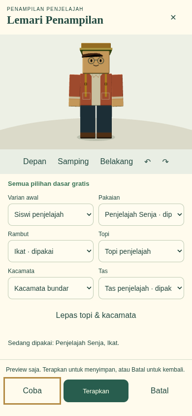

# Visual tahap 03 — karakter modular dan Lemari Penampilan

Mulai diperiksa 29 Oktober 2026 (Asia/Bangkok). Dasar aktual adalah `2582b767666fa243881f6b075dde3e05abf2958a` pada branch `fix/windows-package-path`: visual 01/02 dan paket Windows pendek sudah ada, meskipun belum digabung ke main. AGENTS.md tidak ditemukan di proyek/induk. README, rancangan, rencana/laporan visual, pembangun karakter, animator, galeri, penyimpanan, pergantian wilayah dan launcher diperiksa.

Tahap ini hanya menambahkan penampilan pribadi gratis. Seluruh 17 misi, delapan wilayah, XP, kontrol, kamera, kendaraan, alat dan perbaikan Kota dipertahankan. Tidak ada koin, transaksi pembelian atau toko.

## Cara memakai

Di Kota, buka Peta → **Lemari Penampilan** dan berjalan menuju lemari dekat area persiapan sekolah. Titik interaksi (−10,5; 1), titik pendekatan (−10,5; 2,4); kabinet berada satu unit di belakang titik interaksi. Alternatif dari wilayah mana pun: Pengaturan → **Penampilan · buka lemari**.

1. Pilih varian awal, pakaian, rambut, topi, kacamata dan tas.
2. Tekan **Coba**. Hanya model preview yang berubah.
3. Periksa **Depan / Samping / Belakang**, atau tombol putar.
4. Tekan **Terapkan** untuk menyimpan dan memperbarui avatar dunia. Pilihan baru harus dicoba dahulu.
5. **Batal**, tombol ×, atau Escape menutup tanpa menyimpan preview. “Lepas topi & kacamata” melepas keduanya hanya pada preview; tetap perlu Terapkan.

Memilih varian awal menyiapkan kembali kombinasi bawaan varian itu; setelahnya semua pilihan tetap dapat dipakai pada kedua varian. Semua tombol memakai kontrol HTML asli, dapat dituju dengan Tab dan diaktifkan Enter/sentuhan. Tidak ada drag, hover atau reaksi cepat wajib. Saat lemari terbuka gerak dan lari dihentikan; setelah ditutup diperlukan input baru.

## Katalog gratis dengan ID stabil

Sumber terpusat: `src/data/appearanceCatalog.ts`. Setiap item memuat kategori, nama, konfigurasi visual, kecocokan kedua avatar dan akses `free`. Jenis akses `locked` disiapkan pada tipe data untuk pengembangan, tetapi tidak ada item terkunci/berbayar yang dibuka atau ditawarkan pada tahap ini.

| Slot | ID | Nama |
| --- | --- | --- |
| Avatar dasar | `student-boy` | Siswa penjelajah: Teal + pendek berponi |
| Avatar dasar | `student-girl` | Siswi penjelajah: Senja + rambut ikat |
| Pakaian | `outfit-teal` | Penjelajah Teal, kaus krem, celana gelap, sepatu cokelat |
| Pakaian | `outfit-coral` | Penjelajah Senja, kaus terang, celana biru gelap, sepatu cokelat |
| Rambut | `hair-crop` | Pendek rapi |
| Rambut | `hair-sweep` | Pendek berponi |
| Rambut | `hair-shoulder` | Sebahu |
| Rambut | `hair-tied` | Ikat |
| Kepala | `head-none` / `cap-explorer` | Tanpa topi / Topi penjelajah |
| Wajah | `face-none` / `glasses-round` | Tanpa kacamata / Kacamata bundar |
| Punggung | `back-none` / `pack-mustard` | Tanpa tas / Tas penjelajah |

Dua pakaian adalah satu set lengkap warna jaket/kaus/celana/sepatu. Rambut dan aksesori bisa dipadukan lintas varian, tanpa batas gender. Item dasar ini tidak direncanakan berubah menjadi barang berbayar; pengembangan toko kelak harus memakai ID baru dan aturan kepemilikan tersendiri. Menghilangkan model tas tidak menghilangkan menu Tas atau alat misi.

## Pembangun model, proporsi dan aturan slot

`createCharacter` / `buildReferenceCharacter` yang sama membangun avatar dunia, preview dan galeri. Tidak ada model khusus preview. Enam balok utama tetap kepala, torso, dua lengan dan dua kaki. Wajah menggunakan gambar canvas lokal dan dua oval mata; mata siswa diperjelas, kepala sedikit lebih besar, bahu lebih dekat ke torso, serta kerah, cuff, saku dan sol sepatu memakai tekstur prosedural. Rambut terdiri atas bentuk besar berfungsi, bukan kubus acak. NPC tetap memakai identitas serta normalisasi sebelumnya.

Normalisasi siswa kini memakai enam mesh tubuh netral, **tanpa rambut, topi, kacamata, tas, alat, label dan bayangan**. Tinggi tubuh tetap 1,60 unit, kaki pada Y 0,10, akar navigasi berskala 1, radius tabrakan/interaksi dan target kamera tidak berubah. Sebelumnya skala siswa sekitar 0,416125 karena rambut turut dihitung; skala tubuh sekarang sekitar 0,442600 dari `1,60 / 3,615`. Jadi tinggi sampai ujung rambut/topi dapat berbeda, sementara tubuh dan kemampuan tetap sama. Ini koreksi definisi pengukuran satu kali; tidak ada perkalian 0,85 berulang. Semua 128 kombinasi gratis diuji memiliki ukuran tubuh dan koordinat socket identik.

Pakaian, rambut, topi, kacamata dan tas memiliki kelompok transformasi terpisah. Topi menyembunyikan crown rambut dan memperpendek bagian poni agar tidak menembus brim; bagian belakang/ikat tetap terbaca. Material/geometry cache tidak dimutasi ketika satu avatar berganti pilihan. Cache pakaian dibedakan menurut set dan kebutuhan tali tas, sehingga memilih Tanpa tas juga menghilangkan tali pada jaket.

`setTemporaryEquipment(rig, 'dive' | 'astronaut' | 'none')` menyediakan override sementara. Helm sementara menyembunyikan slot rambut/topi/kacamata/tas tanpa mengubah `rig.appearance`. Melepasnya memulihkan pilihan pribadi. Mode sementara dipertahankan saat rig dunia dibangun ulang oleh Terapkan dan tidak disimpan sebagai kepemilikan. Yang disiapkan sekarang adalah mekanisme override dan geometri helm sederhana, bukan aktivitas menyelam/astronot baru atau pakaian lengkap tahap berikutnya. Rompi berenang/perahu lama tetap bekerja dan memulihkan tas pribadi saat dilepas.

## Preview, kamera dan resource

`WardrobePreview` memakai studio Scene/camera kecil untuk inspeksi dan **renderer WebGL serta loop World yang sudah ada**. Saat lemari aktif hanya studio yang dirender pada area preview; tidak ada renderer kedua atau satu renderer per kartu. Kamera eksplorasi dan preferensi Dekat/Normal/Jauh tetap tersendiri. Rect preview memakai viewport/scissor pada canvas yang sama dan dikembalikan setelah render/penutupan.

Floor studio, material dan geometry milik preview dilepas ketika ditutup. Cache avatar bersama tetap hidup untuk avatar dunia; menutup preview tidak memanggil renderer.dispose. Tiga putaran pergantian pakaian/rambut melalui Terapkan mempertahankan satu avatar dunia, satu akar wilayah dan satu canvas. Resource mencapai cache hangat yang stabil; data rinci tersedia pada bukti di bawah. Cache ini dibatasi katalog tetap, bukan jaminan performa semua perangkat.

## Penyimpanan dan kompatibilitas

Format cadangan terbaru **v18**, versi skema IndexedDB tetap **1**. Rekaman `appearance` ditambahkan pada store `saves`, terpisah dari rekaman misi dan `world`. Transaksi `saveGame` menyimpan snapshot atomik. Terapkan menunggu simpan berhasil sebelum mengganti rig dunia; gagal simpan ditampilkan pada lemari dan pilihan pribadi sebelumnya dipertahankan. Reset misi tidak mengubah penampilan.

Cadangan v18 menyertakan penampilan di tingkat atas, bukan menyisipkannya sebagai misi atau hadiah. Cadangan v1–v17 tetap didukung dan mempertahankan penampilan saat ini. Null/tidak adanya penampilan tidak menghapus pilihan yang sudah ada. ID tidak dikenal, salah kategori, akses tidak sah atau konfigurasi tidak sesuai memakai fallback slot yang aman. Seluruh data misi tetap diperiksa sebelum impor mengubah keadaan aktif.

Pemain tanpa rekaman penampilan mendapat bawaan sesuai `?avatar=siswi` atau siswa. Rekaman yang sudah tersimpan mengalahkan query URL. Galeri membaca rekaman penampilan saja dan tidak menulis progres; memilih karakter lain di galeri tidak mengubah penampilan pribadi. Waktu offline tidak mengganti item, menghasilkan bukti atau memberi XP.

## Bukti dari game sebenarnya

Semua PNG/WebM berasal dari Chromium/SwiftShader yang menjalankan game, bukan mockup atau gambar pengganti. Cahaya galeri/preview memakai nilai fondasi yang sama; pencahayaan pada sudut model berbeda dapat mengubah kesan warna, bukan konfigurasi item.

| Pemeriksaan | Bukti |
| --- | --- |
| Lemari, tiga sisi | [Depan](evidence/visual-stage-03/01-front.png) · [Samping](evidence/visual-stage-03/02-side.png) · [Belakang](evidence/visual-stage-03/03-back.png) |
| Kombinasi yang sama di dunia/galeri | [Dunia](evidence/visual-stage-03/04-world-applied.png) · [Galeri](evidence/visual-stage-03/05-gallery-three-sides.png) · [Detail wajah](evidence/visual-stage-03/06-gallery-face.png) |
| Viewport | [Laptop](evidence/visual-stage-03/07-1440-preview.png) · [HP potret](evidence/visual-stage-03/07-390-preview.png) · [HP lanskap](evidence/visual-stage-03/07-844-preview.png) · [IFP](evidence/visual-stage-03/07-1920-preview.png) |
| Tanpa topi: empat siluet | [Rapi depan](evidence/visual-stage-03/hair-hair-crop-depan.png) · [Berponi samping](evidence/visual-stage-03/hair-hair-sweep-samping.png) · [Sebahu belakang](evidence/visual-stage-03/hair-hair-shoulder-belakang.png) · [Ikat belakang](evidence/visual-stage-03/hair-hair-tied-belakang.png) |
| Tanpa aksesori/tas | [Depan](evidence/visual-stage-03/15-no-accessories-no-pack.png) · [Belakang tanpa tas/tali](evidence/visual-stage-03/16-no-pack-back.png) |
| Build produksi | [Preview](evidence/visual-stage-03/08-starter-cap-glasses-preview.png) · [Avatar dunia](evidence/visual-stage-03/09-same-look-world.png) · [Galeri](evidence/visual-stage-03/11-applied-gallery-production.png) |
| Alat dan aktivitas lama | [Memancing](evidence/visual-stage-03/12-custom-fishing.png) · [Berenang](evidence/visual-stage-03/13-custom-swimming.png) · [Perahu](evidence/visual-stage-03/14-custom-boating.png) |

[Cuplikan berjalan, berlari, mengganti preview dan kembali membawa alat](evidence/visual-stage-03/wardrobe-walk-run-tools.webm) direkam lewat script `scripts/capture-visual-stage-03.mjs` dari build produksi. Pengambilan bukti menggunakan cadangan sah yang diimpor melalui UI; navigasi tetap mengunjungi objek. [Metadata produksi](evidence/visual-stage-03/production-capture.json), [siklus resource](evidence/visual-stage-03/resource-cycles.json), dan [contoh cadangan v18 dari UI](evidence/visual-stage-03/applied-backup-v18.json) disertakan.

## Hasil pemeriksaan

| Perintah / pemeriksaan | Hasil aktual |
| --- | --- |
| `npm test` | **720 lulus**, 24 berkas; termasuk 128 kombinasi, enam blok, tinggi/socket tetap, override sementara dan migrasi seluruh versi 1–17. |
| `npm run test:launcher` setelah pengemasan | **16 lulus**. ZIP diekstrak pada folder Unicode/berspasi; server, peluncuran ulang, diagnostik dan akses tanpa npm diperiksa. |
| `CAPTURE_WARDROBE_EVIDENCE=1 npm run test:e2e` | 110 skenario dijalankan, **108 lulus pada run penuh** (49,3 menit). Dua berhenti hanya karena harapan nama cadangan masih v17. Setelah harapan diubah ke v18, **keduanya lulus pada uji ulang**. Kode aplikasi tidak berubah selama pemeriksaan ini. |
| `npm run test:e2e -- tests/runtimePackage.spec.ts` setelah ZIP baru dibuat | **2 lulus** pada 1280×900 dan 390×844: game/lemari/galeri offline dari isi ZIP, Terapkan/reload, ekspor v18 dan impor v17 dengan XP lama tetap 950. |
| `npm run build` dan `npm run prepare:local` | Keduanya berhasil. Peringatan ukuran chunk >500 kB masih ada; tidak disembunyikan dan bukan pengukuran performa HP. |
| Cuplikan produksi | 107 frame, sekitar 9,15 detik WebM; kecepatan aktual jalan **5,200** dan lari **8,000**. Tidak ada error JavaScript/permintaan aset eksternal pada sesi rekaman. |
| Cache setelah Terapkan berulang | Tiga siklus masing-masing 88 geometri, 38 tekstur, satu avatar dunia dan satu akar wilayah; satu canvas. |

Delapan uji lemari tercakup pada run penuh. Regresi mencakup M01/M02, Kebun, logistik Rimba/gerobak, memancing/berenang/perahu, ROV, seluruh episode M16/M17, Geopark, Antariksa, rendering tahap 01 dan detail/navigasi Kota tahap 02. Seluruh 19 tujuan Kota dikunjungi melalui jalur nyata; tiga siklus wilayah memeriksa pelepasan resource dan bukti misi.

Ringkasan mesin dan log aktual: [checks.json](evidence/visual-stage-03/checks.json), [unit](evidence/visual-stage-03/unit-tests.txt), [browser penuh](evidence/visual-stage-03/browser-full.txt), [dua koreksi](evidence/visual-stage-03/browser-corrections.txt), [launcher paket](evidence/visual-stage-03/launcher-package.txt), [browser ZIP](evidence/visual-stage-03/browser-runtime-package.txt). Hash 139 berkas sumber/konfigurasi diverifikasi sama sebelum dan sesudah rangkaian tes. Perubahan setelahnya hanya dokumentasi, pemeriksaan isi ZIP, dan pengemasan.

ZIP siap main terbaru: [JS-Windows.zip](../unduhan/JS-Windows.zip), **382.481 byte**, 17 entri, jalur terpanjang 43 karakter, CRC dan SHA-256 setiap isi diperiksa. Semua aset build dan galeri tersedia lokal; kode sumber, screenshot/video pengembangan dan node_modules sengaja tidak disertakan. Node.js ≥22.12 masih diperlukan; pemain tidak perlu npm atau build. Ekstrak ke `C:\Game`, buka `JS`, klik `JALANKAN_JELAJAH_SAINS.bat`. [Manifest verifikasi](../unduhan/verification.json).

## Batas yang masih ada

Pengujian HP/IFP adalah simulasi viewport/sentuhan browser Linux, bukan pengujian perangkat fisik, Explorer Windows atau LAN antarperangkat. Kemampuan shader/performa pada HP rendah masih memerlukan pemeriksaan fisik. Aksesori/headwear baru di luar katalog memerlukan aturan visual tersendiri; fallback mencegah ID asing merusak progres tetapi bukan pengganti desain/perizinan item baru.

Slot sementara sudah dapat diuji melalui API; belum ada aktivitas atau koleksi pakaian selam/astronot penuh baru. Tidak ada pewarnaan bebas, unggah aset, koin atau pembelian. Tinggi NPC mempertahankan definisi legacy, sedangkan siswa memakai ukuran tubuh tanpa kosmetik. Penyempurnaan visual wilayah lain dan tahap 04+ menunggu permintaan berikutnya.
