# Tahap 09 — Detail lingkungan dan aktivitas delapan wilayah

Tanggal pemeriksaan: 1 November 2026 (Asia/Bangkok). Branch `feat/visual-stage-09`, dasar `d89eede` dari tahap 08, bukan `main` lama. Fetch branch dilakukan sebelum bekerja; tidak ditemukan AGENTS.md. README, rancangan, rencana visual, laporan tahap terdahulu dan pembangun wilayah diperiksa langsung. Lingkup hanya lingkungan: tidak ada wilayah/ID misi, ekonomi, format cadangan atau skema database baru. Cadangan tetap **v20**, IndexedDB **2**.

## Audit dan hasil per wilayah

| Wilayah | Kondisi awal yang diperiksa | Implementasi tahap ini |
| --- | --- | --- |
| W01 Kota | Sekolah/pasar/observatorium/butik sudah detail; tiga warga dan detail taman tersedia | Pertahankan seluruh bangunan dan kegiatan lama. Tambah kotak tanaman fasad sekolah dan penanda pasar kecil, tanpa menyempitkan plaza/pintu butik. |
| W02 Kebun | Tajuk kotak seragam, rumah semai tertutup, buku berupa papan | Rumah semai berangka dan atap miring, bibit/rak, kusen, tiga siluet pohon, bedengan dekoratif terpisah dengan label, kanal kecil dan alat tani. Satu petani merawat **kebun dekoratif**, bukan enam tanaman M14. Buku/catatan menjadi benda di meja. |
| W03 Rimba | Pohon dan batu seragam, perlengkapan pos minim; bagian atas tangki tertutup model kotak | Tinggi/tajuk pohon bervariasi, akar, serasah, semak, hutan latar opsional, batang patah di kejauhan, atap pos, peti perlengkapan dan satu penjaga memeriksa alat. Penampung berdinding terbuka menampilkan **isi air yang sama** dari progres logistik. Buku ada di meja. |
| W04 Sungai | Tepian sederhana, alat/buku banyak berupa papan | Batu bersisi, vegetasi tepian terpilih, pos beratap, kusen, rak pancing dengan joran, penyangga dermaga, meja buku/catatan, bentuk kran/alat sampling dan rangka saringan/pintu air. Satu pemancing dekoratif di tepian yang aman. |
| W05 Pesisir | Pantai, mangrove, teluk selam, ROV dan perlengkapan sudah dibangun | Selaraskan rak perlengkapan pos dan penyangga di bawah dermaga. Hilangkan papan besar yang menutupi buku/catatan yang sudah berada di meja. Habitat dan area bawah air lama dipertahankan. |
| W06 Bengkel | Alat sains berfungsi, tetapi fasad/rak sederhana dan label terminal menumpuk | Atap miring, kusen, kabinet, rak alat, tray/pipa pada fasad, meja perawatan dan satu teknisi. Label terminal kecil muncul dekat alat; daftar/panel lengkap tetap tersedia. Lampu, derek, turbin, hidraulik dan semua hasil tetap mengikuti model misi masing-masing. |
| W07 Geopark | Tebing berupa lima balok sama, batu berulang, buku dekat pos menjepit kamera | Lapisan dan puncak tebing bervariasi, batu bersisi, pohon, pegangan jalur, pengunjung mengamati maket singkapan. Buku/catatan pada meja. Batas meja dan tulisan **MAKET · MODEL DIPERCEPAT** membedakannya dari bentang alam. Meja buku dipindah dari `(-11,11)` ke `(-11,7)` agar kamera tidak terjepit pos. Peta/penghalang mengikuti posisi baru. |
| W08 Antariksa | Stasiun, model astronomi, perjalanan dan airlock sudah detail | Tambah kabinet diagnostik kecil, pegangan dan satu awak di sisi lorong. Tidak merombak instrumen astronomi, kendaraan, EVA atau pencahayaan benda langit. Awak berhenti diperbarui saat instrumen/EVA aktif. |

Jalur utama sengaja tetap lapang. Akses rumah semai/bangunan yang sebelumnya diblokir bukan interior baru. Pohon, batu dan tanaman merupakan ilustrasi generik; warna batu tidak dipakai untuk klasifikasi atau penyelesaian S19. Tidak ada klaim habitat/spesies baru. Materi ilmiah tetap mengikuti sumber dan keterbatasan telaah yang tercatat pada laporan misi (termasuk batas habitat lamun/mangrove di [tahap 06](visual-stage-06-review.md)); dekorasi tidak dipakai sebagai bukti belajar.

## Stabilitas yang benar-benar diperiksa

Pada rute dan putaran kamera yang direkam, tidak ditemukan kedipan permukaan baru yang dapat direproduksi. Tidak mematikan depth, mengubah near/far, FOV, bayangan kontak, atau menyembunyikan seluruh efek air. Tepi bergerigi pada SwiftShader dan perpindahan label bukan z-fighting.

Dua masalah terbukti ditangani: label terminal Bengkel membesar/tumpang tindih dari jauh; kamera di pendekatan buku Geopark terdorong pos hingga membesarkan punggung avatar memenuhi layar. Label kini mempunyai ukuran/aspek khusus dan jarak tampil; posisi buku Geopark diperbaiki bersama navigasinya. Pohon latar dan siluet area terdampak Rimba juga diberi tanah pijakan; slab tambahan bertemu di tepi, tidak menumpuk pada tanah lama. Ketinggian volume kamera atap disesuaikan dengan bentuk baru. Buku Kebun/Rimba juga memakai volume kamera setinggi meja, bukan dinding imajiner.

Dekorasi ikan/riak Sungai kini berhenti saat panel/jeda, tab tersembunyi atau kehilangan fokus. `activityDelta` membedakan jeda gerak darat dari instrumen yang sengaja dijalankan siswa: rotor energi tetap bergerak pada kondisi model saat panel instrumennya aktif, dan efek penyiraman tetap terlihat saat tindakan M14. Menu/jeda di luar pengamatan membekukan visual tersebut. Pembekuan panel yang semula terlalu luas dikoreksi dan diuji ulang. Tidak ada data, air atau energi baru yang dihasilkan oleh delta visual.

## Aktivitas, kualitas, dan kepemilikan resource

`EnvironmentKit` membangun bentuk miring/silinder/batu/tajuk dan menggabungkan geometri statis menurut material. Setiap wilayah memiliki asetnya sendiri; geometri sementara dilepas setelah penggabungan. Geometri/material avatar yang bertanda milik cache tetap dipertahankan oleh `disposeRegion`.

`regionalEnvironment` hanya membaca waktu aktif, kualitas, pengurangan gerakan dan jarak pemain. Modul ini tidak memiliki referensi ke penyimpanan, inventaris, reward atau transisi misi. Aktor dekoratif tidak memiliki `PlaceId`, tidak menjadi target misi dan berdiri pada tapak yang diblokir. NPC misi tetap di tempatnya, memakai interaksi/gerak menghadap pemain yang sudah ada. Tidak ada rute NPC misi baru yang meninggalkan target pada posisi lama.

Batas tambahan per wilayah: satu aktor dekoratif (Kebun, Rimba, Sungai, Bengkel, Geopark, Antariksa), paling banyak enam daun bergerak, **nol partikel dan lapisan transparan baru**. Material batch statis pada kit dibatasi 24 dan diperiksa. Kota tetap memakai tiga warga dari tahap 02; Pesisir tidak menambah aktor. Kualitas Rendah menyembunyikan aktor tambahan dan latar opsional, tetapi mempertahankan bentuk utama, buku, rak, objek misi dan data. Pengurangan gerakan menahan pose aktivitas; input pemain dan alat sains tetap tersedia. Tidak ada resource baru per frame, listener, timer, renderer atau loop kedua.

## Cara mencoba

1. Jalankan paket produksi terbaru. Buka **Peta**, pilih gerbang Kota menuju Kebun/Rimba/Sungai/Bengkel. Geopark melalui terminal Bengkel, Pesisir melalui dermaga Sungai, Antariksa melalui Observatorium dan kendaraan yang sudah tersedia.
2. Berjalan/berlari ke buku, NPC dan alat; bandingkan bentuk objek dengan panelnya. Navigasi Peta hanya mengantar; membaca/mencatat tetap tindakan pemain.
3. Dekati kebun dekoratif, perlengkapan pos, tepian pemancing, meja perawatan, singkapan Geopark dan konsol awak. Buka panel untuk melihat aktivitas berhenti.
4. Uji **Pengaturan → Pengurangan gerakan / Kualitas Rendah**, kemudian kembali ke wilayah lain dan kembali lagi. Kontrol lama tetap: WASD/panah, Shift, E; analog dan kamera terpisah; tujuan sentuh IFP.

## Bukti dari game produksi

Seluruh gambar dan video berasal dari Chromium yang menjalankan build produksi lokal, bukan mockup. Perbandingan memakai viewport **1280×800**, IFP, kualitas Normal, jarak kamera bawaan/yaw yang sama dan fixture historis yang sama. Titik spawn tetap sama. Dua rute tiap wilayah memakai ID tujuan yang sama; **meja buku Geopark berpindah** sehingga gambar pendekatannya menunjukkan perbaikan framing, bukan posisi kamera dunia identik. Cuplikan memuat navigasi nyata, aktivitas dan putaran kamera. Kondisi misi lengkap pada fixture adalah alat pemeriksaan, bukan progres baru yang diberikan pada permainan.

| Wilayah | Sebelum | Sesudah | Cuplikan setelah |
| --- | --- | --- | --- |
| Kebun | 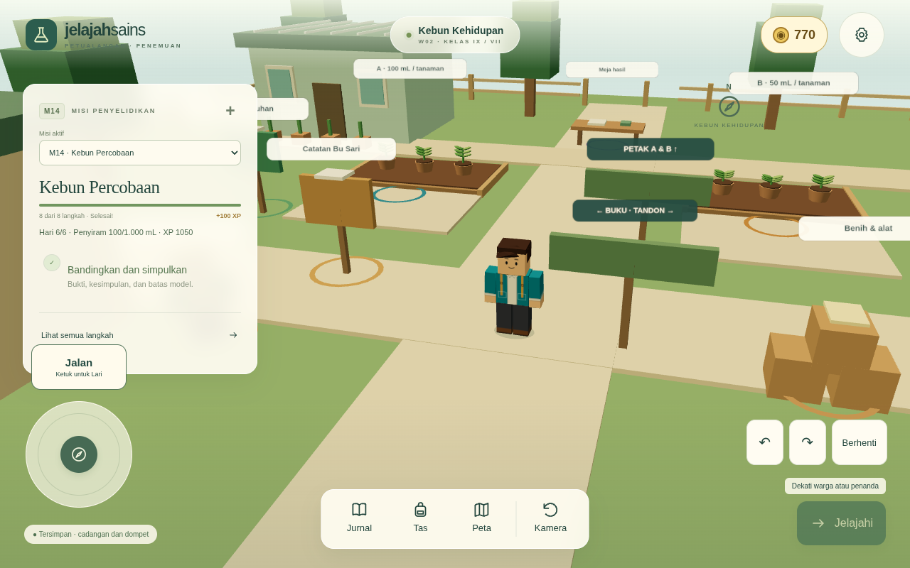 | 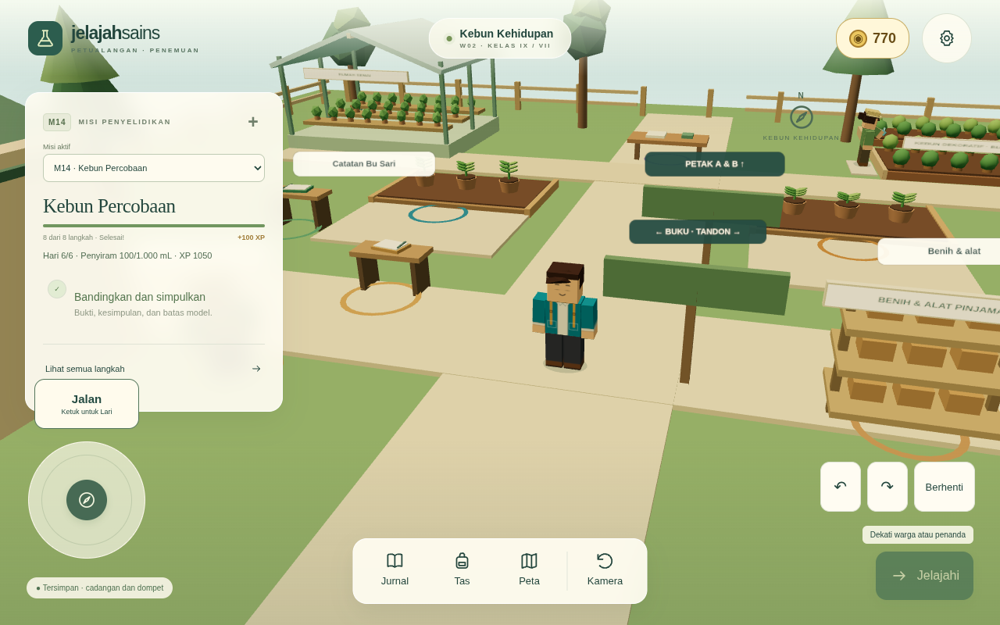 | [Jelajah Kebun](evidence/visual-stage-09/after-garden.mp4) |
| Rimba | 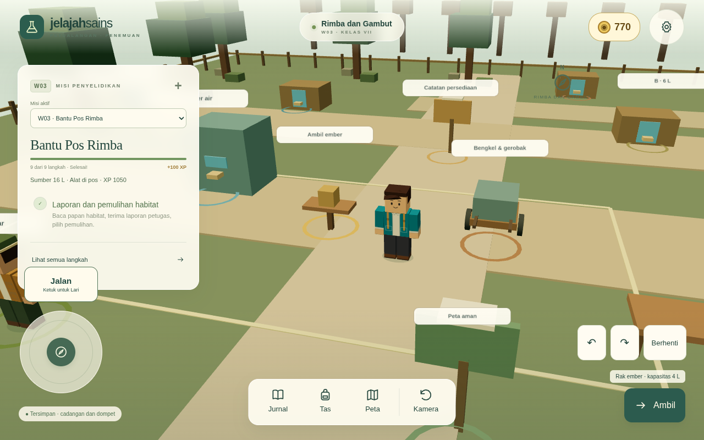 | 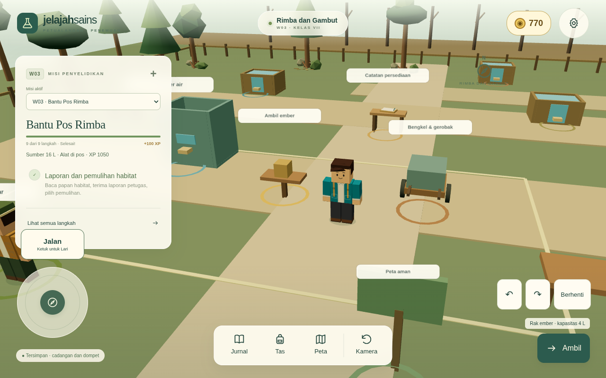 | [Jelajah Rimba](evidence/visual-stage-09/after-rimba.mp4) |
| Sungai | 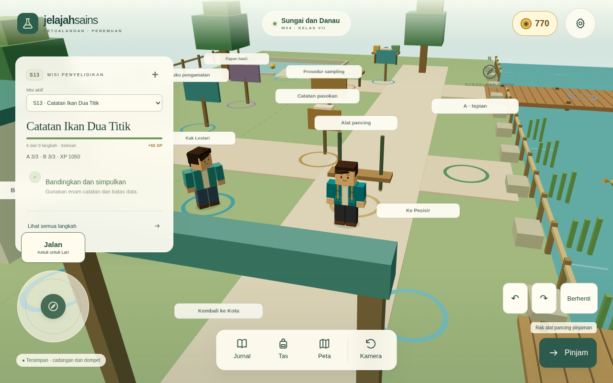 | 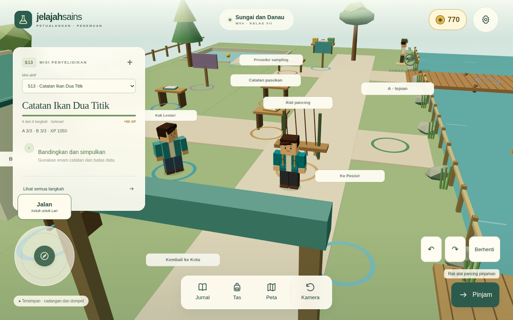 | [Jelajah Sungai](evidence/visual-stage-09/after-river.mp4) |
| Bengkel | 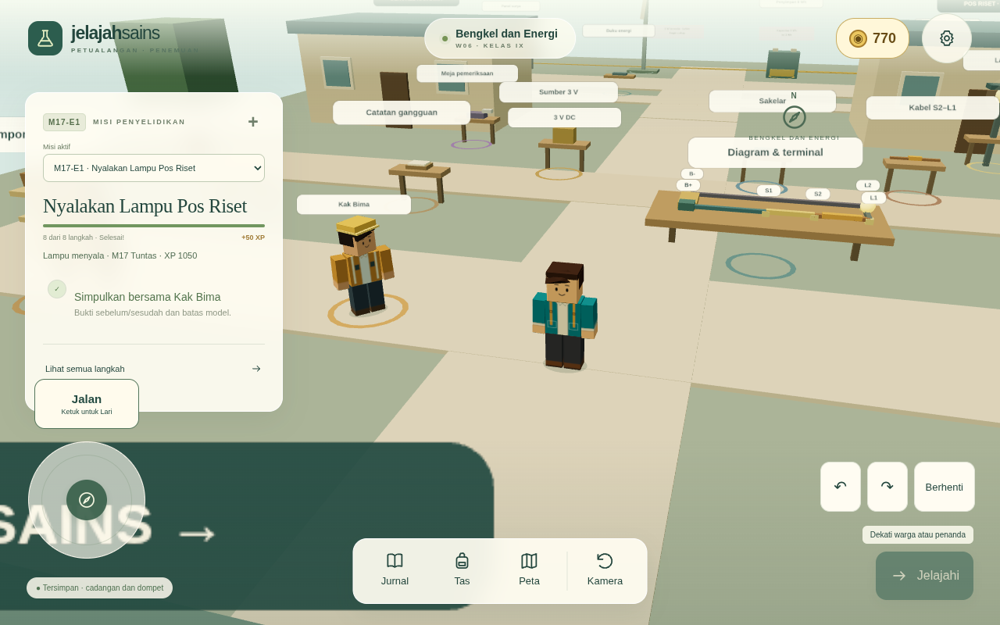 | 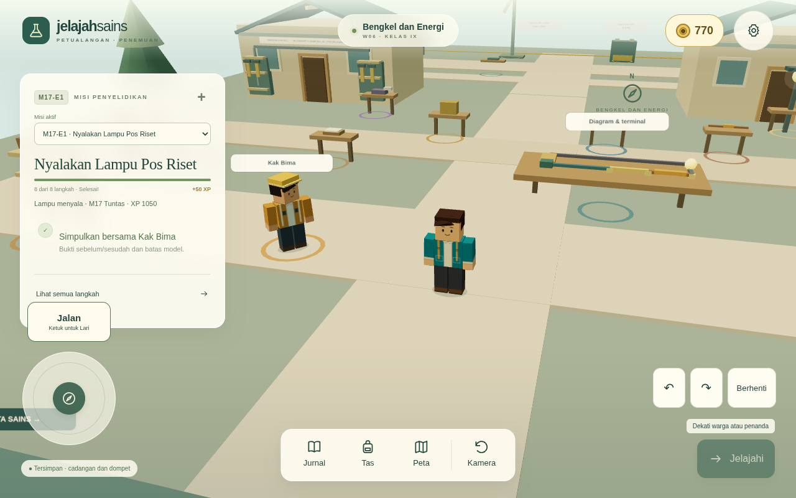 | [Jelajah Bengkel](evidence/visual-stage-09/after-workshop.mp4) |
| Geopark | 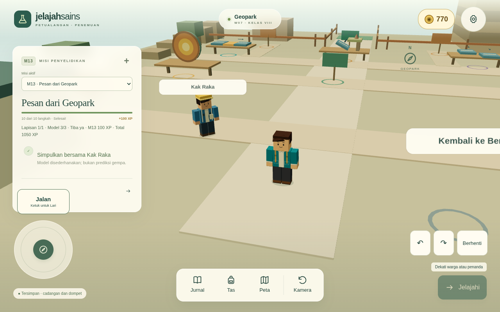 | 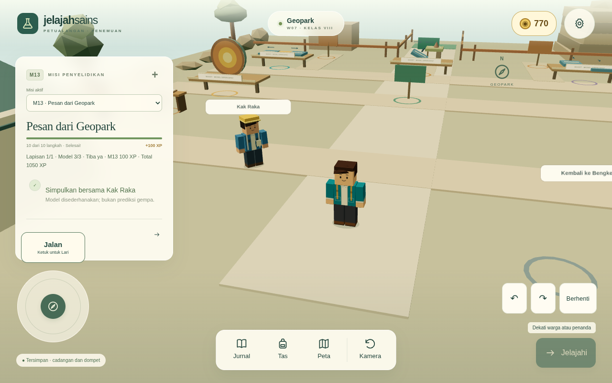 | [Jelajah Geopark](evidence/visual-stage-09/after-geopark.mp4) |
| Kota | 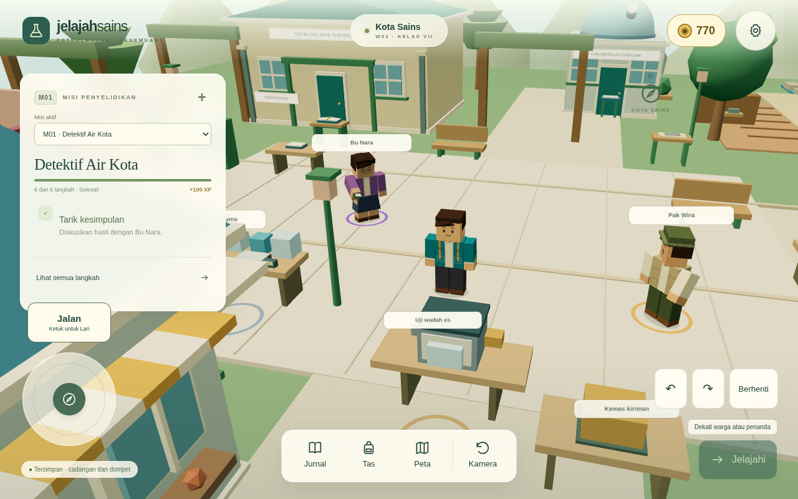 | 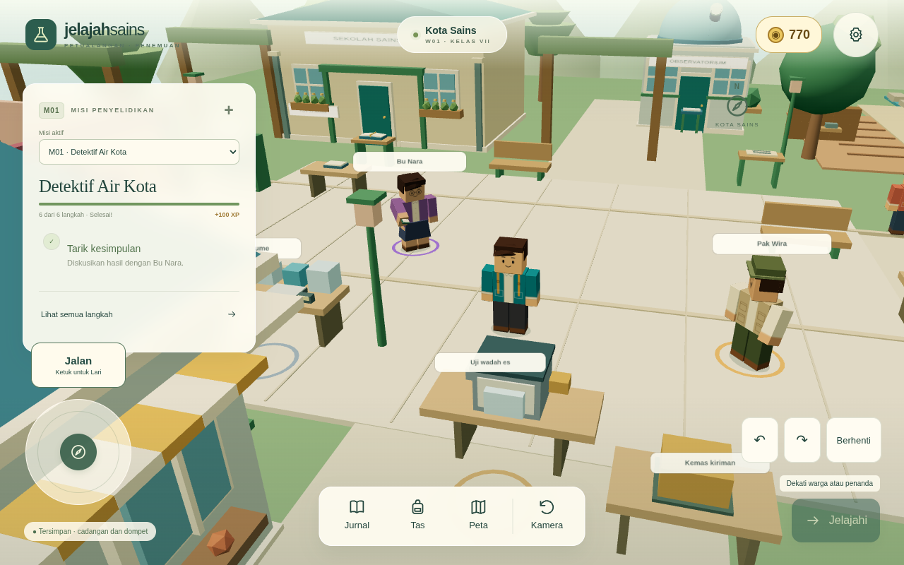 | [Jelajah Kota](evidence/visual-stage-09/after-town.mp4) |
| Pesisir | 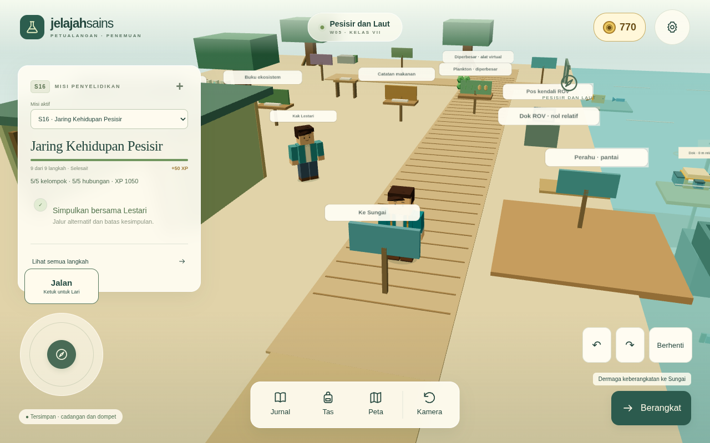 | 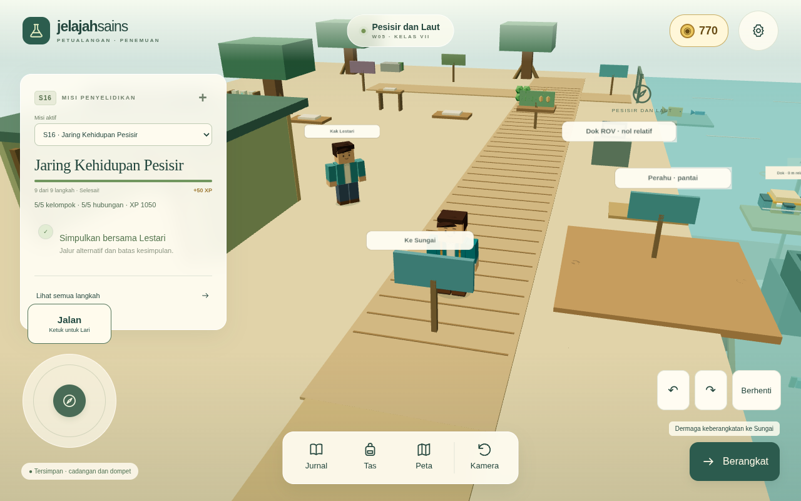 | [Jelajah Pesisir](evidence/visual-stage-09/after-coast.mp4) |
| Antariksa | 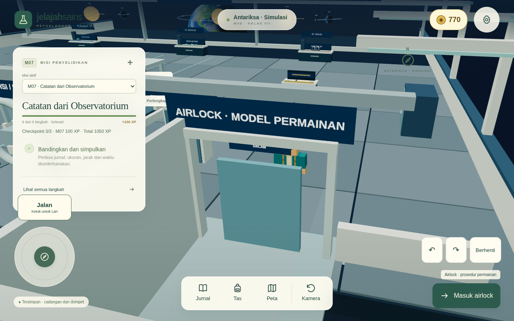 |  | [Jelajah stasiun](evidence/visual-stage-09/after-space.mp4) |

Tambahan: [buku Geopark sebelum](evidence/visual-stage-09/before-geopark-route-1.png) / [setelah](evidence/visual-stage-09/after-geopark-route-1.png); [rak pancing](evidence/visual-stage-09/after-river-spawn.png); [perlengkapan pos](evidence/visual-stage-09/after-rimba-route-1.png); [awak stasiun](evidence/visual-stage-09/after-space-route-1.png). Gambar `route-1/2` dan video sebelum tersedia di folder bukti yang sama. Video hanya dipangkas bagian awal menu dan dikompresi H.264; laju perjalanan tidak dipercepat.

## Pemeriksaan

- `npm test`: **889 lulus / 30 berkas**, termasuk 30 pemeriksaan lingkungan baru, seluruh aturan misi, navigasi, tekanan, energi, neraca air, ekonomi dan kompatibilitas data.
- `npm run test:launcher`: **16 lulus** (pengujian Node/Linux).
- `npm run build` dan `npm run prepare:local`: berhasil. Peringatan ukuran chunk Vite dan deprekasi Three.Clock masih ada; tidak menambah dependensi.
- `npm run test:e2e -- tests/visualStage09.spec.ts`: **7 lulus** pada kode akhir, setelah memperbaiki asersi teks konfirmasi pada uji baru dan menambah pemeriksaan turbin pada panel aktif versus menu jeda. Semua delapan wilayah ditempuh melalui Peta ke buku/alat dan NPC, posisi kedatangan diperiksa, lalu reload. Pembelian nyata via toko pada fixture dilakukan sebelum rute: catatan 17 misi, wallet/receipt dan penampilan berbayar tetap sama. Ini pemeriksaan preservasi, bukan klaim menuntaskan ulang seluruh misi.
- Empat viewport baru: laptop 1440×960, HP 390×844 dan 844×390, IFP 1920×1080. Jeda, pengurangan gerakan, Rendah, tujuan buku dan input baru setelah tutup panel diperiksa; tidak ada overflow halaman. [Gambar HP potret](evidence/visual-stage-09/viewport-390x844.png) · [lanskap](evidence/visual-stage-09/viewport-844x390.png) · [laptop](evidence/visual-stage-09/viewport-1440x960.png) · [IFP](evidence/visual-stage-09/viewport-1920x1080.png).

[Hasil rute/progres](evidence/visual-stage-09/navigation-preservation.json) dan [tiga putaran resource](evidence/visual-stage-09/resource-cycles.json) tersimpan. Jumlah geometri pada graf wilayah identik di setiap putaran: Kebun 118, Rimba 186, Sungai 217, Bengkel 258, Geopark 107, Kota 138, Pesisir 170, Antariksa 141. GPU cache/upload dan frustum membuat jumlah yang sudah dirender bervariasi; putaran ketiga tidak melewati puncak dua putaran sebelumnya. Ini pemeriksaan kebocoran terarah, bukan profil memori jangka panjang.

Regresi lengkap terarah: **8 lulus** (`garden`, `rimba`, `river`, `workshop`, `geopark`, `space`, `electromagnet`, `energy`, memilih alur IFP lengkap). M14, W03-LOG01, S13, M13, M07 dan ketiga episode M17 tetap dapat diselesaikan. Setelah koreksi pembekuan visual, alur lengkap **M14 dan M17-E3 diulang: 2 lulus**. Uji khusus instrumen memastikan rotor berputar pada pengujian 5 W sebelum Catat, tidak otomatis menambah rekaman, dan berhenti pada Pengaturan.

Pemeriksaan kontrol/vehicle terarah: **12 lulus**. Mencakup jalan/lari, Shift kiri/kanan, diagonal, tabrakan sekolah, ketik/blur/tab tersembunyi, analog + kamera dua jari pada dua orientasi HP, navigasi IFP, perahu, ROV, kolam S14, sambungan medan Rimba–Bengkel, seluruh tujuan Kota, perjalanan/docking/airlock/EVA dan selam dengan pemulihan kostum.

Paket produksi: `npm run test:e2e -- tests/runtimePackage.spec.ts` **5 lulus**. ZIP diekstrak ke folder berspasi/Unicode, tanpa `node_modules`; seluruh permintaan eksternal diblokir. `index.html` dan `character.html`, tiga tekstur astronomi lokal, instrumen, EVA, selam, butik, pembelian nyata dari fixture dan reload lulus pada viewport 1280×900/390×844. Launcher diuji ulang: **16 lulus**. ZIP terbaru **649.601 byte**, 20 entri, jalur terpanjang 40 karakter; CRC, seluruh hash manifest dan kecocokan dengan `dist` hasil persiapan lulus. [Verifikasi paket](../unduhan/verification.json).

Ini **34 eksekusi browser terarah yang lulus** (7 + 8 + 2 pengulangan terdampak + 12 + 5), bukan pengulangan seluruh suite browser. Perintah dan lingkup lengkap ada pada [checks.json](evidence/visual-stage-09/checks.json). Pendekatan di tepi seberang memakai titik sandar; penanda kolam memakai area berenang. Uji navigasi mempertahankan pemisahan izin darat/air yang sudah ada. Angka waktu pada JSON rekaman visual bukan benchmark karena ada pekerjaan lain yang berjalan bersamaan.

## Perbandingan performa terkontrol

Linux container, Chromium **154.0.8037.57**, ANGLE **SwiftShader (software)**, Node **24.19.0**; host AMD EPYC 9V45 dengan **4 CPU tersedia** bagi proses. Kedua build dijalankan **berurutan**, tanpa uji/build/video/screenshot bersamaan. Build sebelum dipertahankan terpisah dari commit tahap 08 `d89eede`; kode game setelah `67c23b8`. Fixture, viewport 1280×800, DPR 1, spawn, jarak kamera Normal dan yaw 0,25 sama. Sampel idle: tiga blok RAF masing-masing 1,8 detik per wilayah. Angka berikut adalah median dari tiga median/p95 blok; ms lebih rendah lebih baik. Ini bukan benchmark berjalan atau performa HP fisik.

| Wilayah | Normal sebelum median / p95 ms | Normal setelah median / p95 ms | Draw sebelum → setelah | Segitiga sebelum → setelah | Rendah setelah median / p95 ms (draw) |
| --- | --- | --- | --- | --- | --- |
| Kebun | 50.0 / 66.7 | 50.0 / 66.7 | 184 → 249 | 6226 → 11770 | 50.0 / 83.2 (206) |
| Rimba | 49.9 / 66.7 | 50.0 / 83.3 | 142 → 172 | 6552 → 10756 | 50.0 / 66.7 (168) |
| Sungai | 49.9 / 83.3 | 50.0 / 66.7 | 168 → 231 | 5714 → 8450 | 50.0 / 66.7 (190) |
| Bengkel | 50.0 / 66.7 | 50.0 / 66.7 | 195 → 233 | 4912 → 7030 | 50.0 / 66.7 (192) |
| Geopark | 33.4 / 66.6 | 49.9 / 66.6 | 163 → 226 | 4554 → 6942 | 33.4 / 50.1 (183) |
| Kota | 83.3 / 100.0 | 66.7 / 83.4 | 372 → 377 | 13520 → 14038 | 66.7 / 100.1 (370) |
| Pesisir | 33.4 / 66.6 | 33.4 / 66.6 | 192 → 191 | 4452 → 4768 | 49.9 / 66.6 (191) |
| Antariksa | 83.3 / 100.0 | 83.3 / 100.0 | 164 → 164 | 56112 → 56112 | 66.7 / 83.4 (158) |

Detail dan aktor menambah draw call/segitiga di lima wilayah prioritas. Geopark Normal menunjukkan beban lebih tinggi (33,4 → 49,9 ms median); Rendah kembali 33,4 ms pada sampel ini. Rendah menurunkan draw call ketika detail opsional masuk pandangan dan sangat mengurangi segitiga Antariksa (56.112 → 16.714). **Rendah tidak selalu menghasilkan waktu bingkai lebih rendah** pada sampel pendek ini; misalnya Pesisir memiliki jumlah draw sama tetapi median berbeda. Penjadwalan container, pose/frustum dan interval RAF yang bertingkat membatasi kesimpulan. Perubahan Kota bukan bukti optimasi FPS umum. Jangan menyebut angka SwiftShader sebagai hasil GPU HP atau jaminan 60 FPS.

[Data mentah, kondisi dan ringkasan](evidence/visual-stage-09/performance-comparison.json). JSON `perf-before/after/low-*` menyimpan ketiga sampel dan diagnostik tiap wilayah. Angka pada rekaman visual awal tidak dipakai sebagai benchmark karena ada pekerjaan lain bersamaan.

## Batas pemeriksaan

Pemeriksaan ini memakai browser Linux/Chromium dengan **SwiftShader**. Viewport HP/IFP merupakan simulasi ukuran dan sentuhan; belum diuji pada HP, IFP, Windows atau LAN fisik. Gambar penuh dan frame bertahap dari cuplikan bergerak ditinjau; belum setiap frame/sudut diuji. Tidak menjamin FPS perangkat nyata atau seluruh kombinasi sudut kamera bebas kedipan. Audit visual mencakup rute dan putaran kamera yang direkam, bukan setiap koordinat delapan wilayah. Detail tinggi masih dapat menghalangi pandangan pada sudut ekstrem; kontrol putar/jarak kamera tetap tersedia.

Tidak menambah interior yang bisa dimasuki pada semua gedung, NPC kerumunan, suara, klasifikasi organisme/batuan, misi, hadiah atau ekonomi. Tahap 10 belum dikerjakan. Perlu pemeriksaan perangkat sasaran sebelum meningkatkan jumlah detail/aktor lebih jauh.
